# The fault library on film (stage 3)

Episodes of every new fault type at a strong level, each beside its healthy twin (same task, start state and seeds), X-VLA fp16_res32 on `libero_spatial`, from run `s3-films` of the stage-3 calibration. Each strip shows five frames of the scene camera from the first step to the last, upright, as the fleet logs them (after the observation hooks); the videos (scene and wrist, MP4) are in `~/.cache/robots-probes/faults/runs/s3-films/log/video/` under each episode's id. Made with `python -m fleetlab.dose_response_stage3 films`.

## sensor

### `lens_contamination`, 1 scene film

- healthy `e000000` (placed, logged success, 85 steps)

  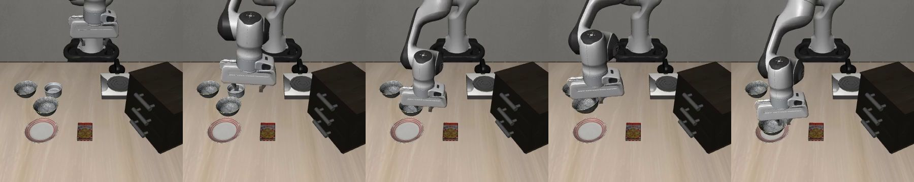

- faulted `e124000` (placed, logged success, 87 steps)

  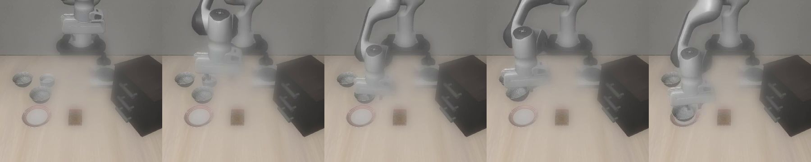

- healthy `e000001` (failed, logged failure, 280 steps)

  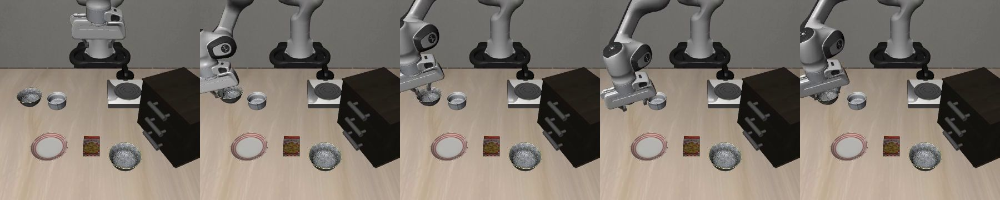

- faulted `e124001` (placed, logged success, 125 steps)

  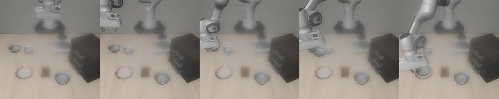

### `camera_latency`, 12 steps scene lag

- healthy `e000000` (placed, logged success, 85 steps)

  

- faulted `e132000` (placed, logged success, 114 steps)

  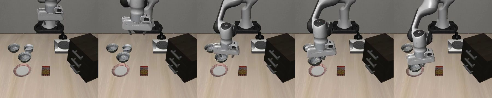

- healthy `e000001` (failed, logged failure, 280 steps)

  

- faulted `e132001` (placed, logged success, 150 steps)

  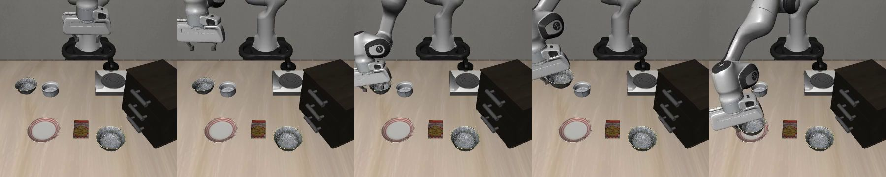

### `camera_pose_offset`, 4 deg scene tilt down

- healthy `e000000` (placed, logged success, 85 steps)

  

- faulted `e007000` (placed, logged success, 97 steps)

  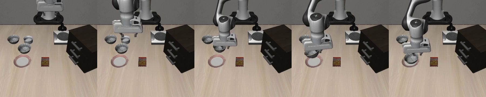

- healthy `e000001` (failed, logged failure, 280 steps)

  

- faulted `e007001` (placed, logged success, 133 steps)

  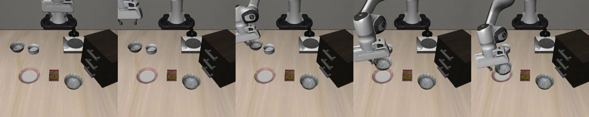

## physical

### `gripper_force_loss`, 0.5 force lost

- healthy `e000000` (placed, logged success, 85 steps)

  

- faulted `e142000` (placed, logged success, 132 steps)

  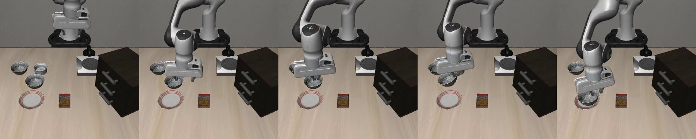

- healthy `e000001` (failed, logged failure, 280 steps)

  

- faulted `e142001` (failed, logged failure, 280 steps)

  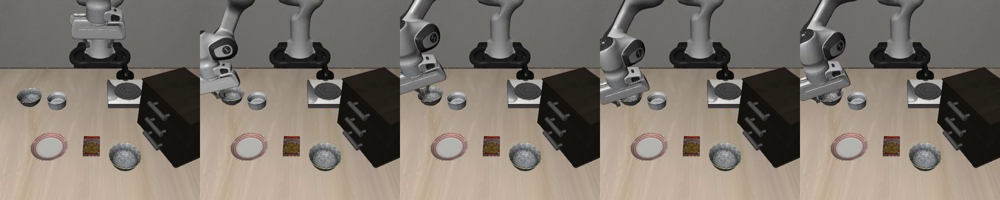

### `gripper_sticky_release`, 20 steps late open

- healthy `e000000` (placed, logged success, 85 steps)

  

- faulted `e153000` (failed, logged failure, 137 steps)

  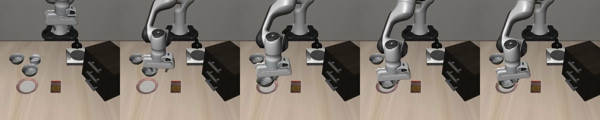

- healthy `e000001` (failed, logged failure, 280 steps)

  

- faulted `e153001` (failed, logged failure, 280 steps)

  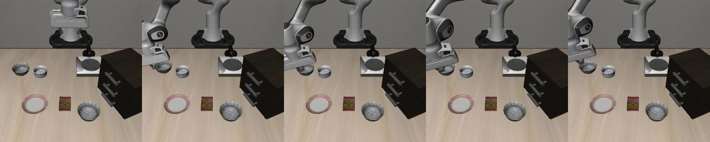

### `arm_torque_loss`, 0.2 torque lost

- healthy `e000000` (placed, logged success, 85 steps)

  

- faulted `e162000` (placed, logged success, 86 steps)

  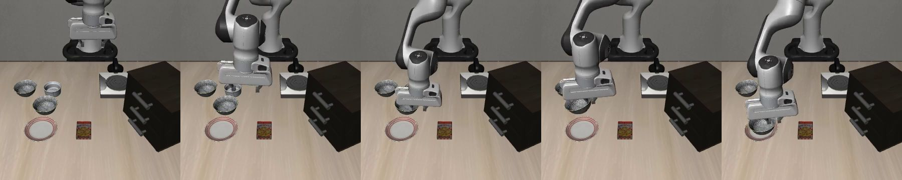

- healthy `e000001` (failed, logged failure, 280 steps)

  

- faulted `e162001` (placed, logged success, 126 steps)

  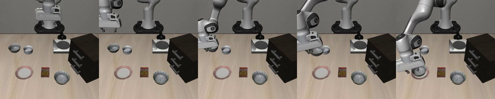

### `controller_overload`, 0.1 cycles missed

- healthy `e000000` (placed, logged success, 85 steps)

  

- faulted `e173000` (placed, logged success, 101 steps)

  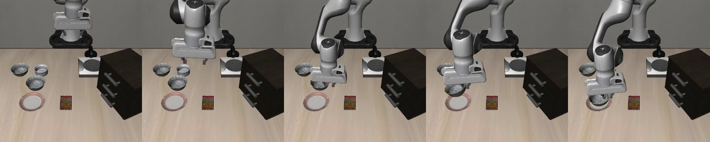

- healthy `e000001` (failed, logged failure, 280 steps)

  

- faulted `e173001` (placed, logged success, 172 steps)

  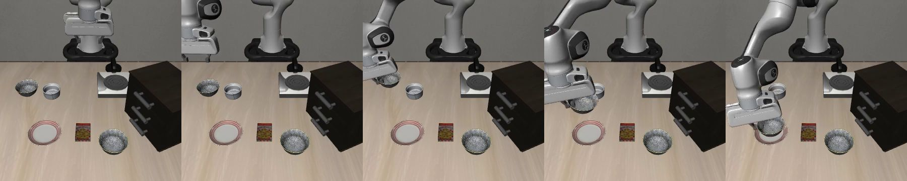

## configuration

### `calibration_update`, scene calibration rewritten

- healthy `e000000` (placed, logged success, 85 steps)

  

- faulted `e181000` (placed, logged success, 85 steps)

  

- healthy `e000001` (failed, logged failure, 280 steps)

  

- faulted `e181001` (failed, logged failure, 280 steps)

  

## software

### `image_pipeline_release`, 10% cropped

- healthy `e000000` (placed, logged success, 85 steps)

  

- faulted `e192000` (placed, logged success, 85 steps)

  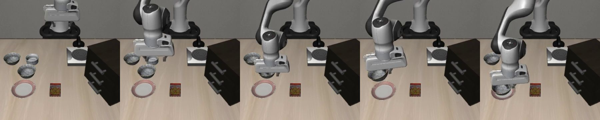

- healthy `e000001` (failed, logged failure, 280 steps)

  

- faulted `e192001` (placed, logged success, 122 steps)

  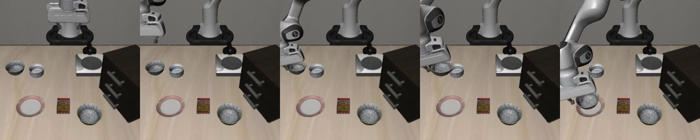

### `software_release`, release with a 14-step delay and 10 actions per chunk

- healthy `e000000` (placed, logged success, 85 steps)

  

- faulted `e052000` (placed, logged success, 262 steps)

  

- healthy `e000001` (failed, logged failure, 280 steps)

  

- faulted `e052001` (failed, logged failure, 280 steps)

  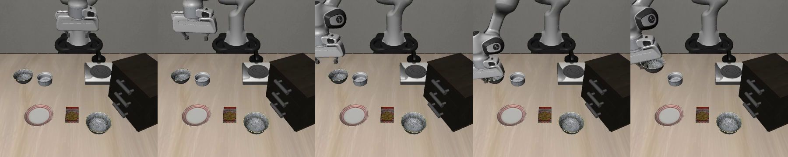

## site

### `table_height_change`, 2 cm lower

- healthy `e000000` (placed, logged success, 85 steps)

  

- faulted `e202000` (placed, logged success, 114 steps)

  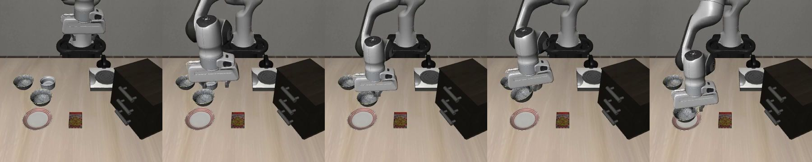

- healthy `e000001` (failed, logged failure, 280 steps)

  

- faulted `e202001` (placed, logged success, 132 steps)

  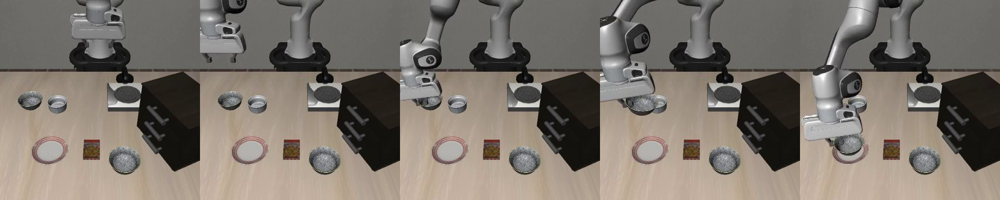

### `light_color_shift`, 1 warmer

- healthy `e000000` (placed, logged success, 85 steps)

  

- faulted `e212000` (placed, logged success, 86 steps)

  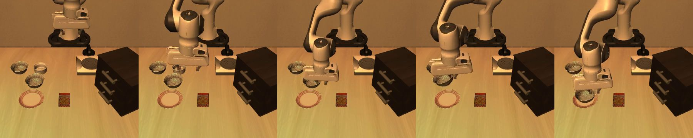

- healthy `e000001` (failed, logged failure, 280 steps)

  

- faulted `e212001` (placed, logged success, 131 steps)

  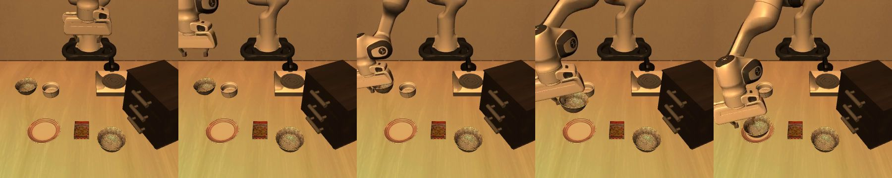

## data

### `success_false_positive`, 1 on a 6 deg camera

- healthy `e000000` (placed, logged success, 85 steps)

  

- faulted `e223000` (failed, logged success, 280 steps)

  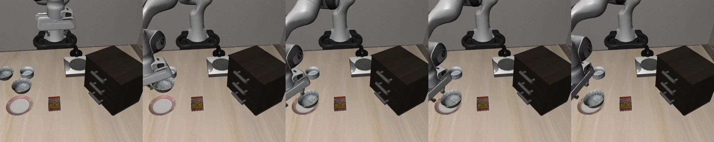

- healthy `e000001` (failed, logged failure, 280 steps)

  

- faulted `e223001` (placed, logged success, 125 steps)

  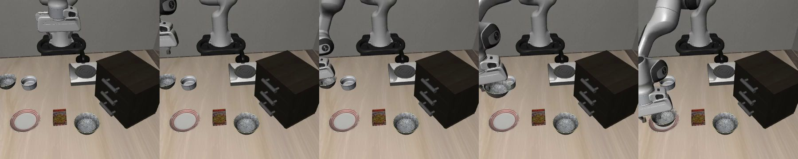

