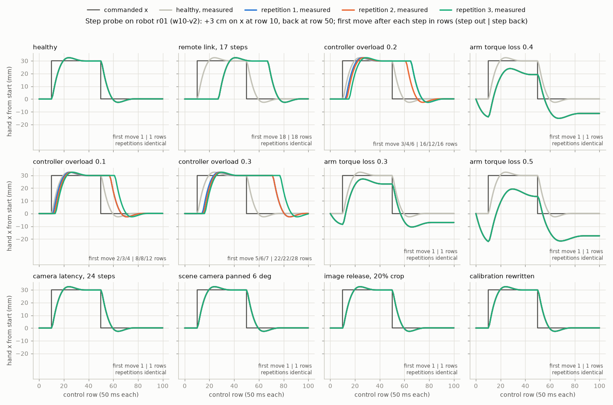

# Step responses of the lookalike causes: the instrument spike (lane P, step 1)

Spike for story B of the two-day demo (lane P), evening of 19 October 2026, branch
`demo/instrument` from `main` at `2c3da47`. All of it is host-side development
evidence: the conditions, their levels and the probe program were chosen by us,
not by an agent, and nothing here goes to an agent. Results are under
`~/.cache/robots-probes/demo/2026-10-20/instrument/`.

The question: does the step-response probe the agent can compose show
distinguishable shapes for the causes that make a robot look as if it lags its
commands? Does ordinary task telemetry already separate them? Does the
intervention catalogue offer a remedy for each?

## Verdict

**The measured mechanism of each condition**, one line each, from the probe
(sections 2 and 3; rows are control steps of 50 ms) and from ordinary task
telemetry (section 4; "placed" is attempts of 100 that ended with the object
placed, against 98 for the healthy twins):

| Condition, level | Probe signature, measured | Ordinary-task symptom, measured |
|---|---|---|
| `remote_link_latency`, 17 steps | A fixed dead time: the hand first moves 18 rows after every step, in every repetition, then follows the healthy curve. | 53 placed; `lag.sql` 20 (healthy 3), the same in every episode. |
| `controller_overload`, 0.2 | A dead time that grows and varies: 3, 4 or 6 rows after the first step, 12 to 16 after the second; healthy shape once a command arrives. | 56 placed; `lag.sql` 24; per-episode lag spread 17.5 to 27, growing from 18 to 31 within an episode. |
| `arm_torque_loss`, 0.4 | No dead time, nearly healthy rise (half-way 5 rows), but the hand sags: it starts 18 mm back and 30 mm low and settles 11 mm short and 14 to 15 mm low. | 56 placed; `lag.sql` 3; the hand runs 16 mm below its commands. |
| `camera_latency`, 24 steps | Prompt: identical to healthy, row for row. | 54 placed; `lag.sql` 3. |
| `camera_pose_offset`, 6 degrees of pan | Prompt: identical to healthy, row for row. | 57 placed; `lag.sql` 3. |
| `image_pipeline_release`, 20% crop | Prompt: identical to healthy, row for row. | 71 placed; `lag.sql` 3. |
| `calibration_update` | Inert: identical to healthy. | 98 placed (no effect); `lag.sql` 3. |

The other levels follow the same patterns: the overload at 0.1 and 0.3 grows
more slowly or faster, and the torque loss at 0.3 and 0.5 sags less or more
(section 3).

**The probe shows four shapes, distinguishable by eye and by its numbers.**
These are fixed dead time, growing and variable dead time, prompt but sagging
and short, and prompt and healthy. The storyboard's "smeared response" does not
exist in this library: neither slow-arm fault rounds the response off.

**Recommended lookalike set**, with the levels measured here:

1. **The lasting condition: `remote_link_latency` at 17 steps** on every robot
   of one site. This is the adaptation spike's level: 53 of 100 placed, and
   compensation of 17 wins back about 47 points.
2. **The lookalike with the same ordinary symptom: `controller_overload` at 0.2**
   on one robot at another site. It produces the same success drop (56 against
   53 of 100) and the same kind of alignment lag (24 against 20) as the link,
   but a different probe signature: its dead time grows, and the two edges of
   one probe already show it. The catalogue's remedy is `service` of the
   robot's controller (3 operator hours). In the story it is "a controller that
   falls behind", not a sluggish arm.
3. **The prompt cause at a third site, or for the second use:** `camera_latency`
   at 24 steps (54 of 100). Its probe is the healthy one, so the check says
   "not a command delay; do not compensate", and the remedy is `service` of
   the scene camera (3 hours). The plan's same-day confounder fits this
   library as `image_pipeline_release` at 20% crop (71 of 100; remedy:
   `revert software.version`, 0.1 hours), logged on the day of a
   `calibration_update` (inert, so "the camera is innocent"). Both leave the
   probe identical to healthy.

`arm_torque_loss` (0.4: 56 of 100) is a success-drop lookalike but not a
lag lookalike. Its records show no command lag, only the hand running low, so
it is not the second cause the plan asks for. Its probe signature (prompt, low
and short) is the clearest of all, if a "worn arm" beat is wanted later.

**Is the probe the only evidence?** No. `lag.sql`'s one number per robot does
not tell the link from the overload (20 and 24). The same ordinary records,
read per episode, do: the spread of the lag, its growth within an episode, and
a residual three times larger. The probe is cleaner and cheaper evidence
rather than the only evidence. Two or three probe episodes of 5 seconds give
an answer that is identical in every repetition for the link and plainly
growing for the overload, with no policy in the loop.

**Compensation under the overload, measured after the spike** (the
coordinator's heavy job from `b4e619c`: 180 X-VLA attempts, `chain_ok` true;
section 7). Overload 0.2 on the adaptation spike's 60 paired starts:

- **Compensation 0:** 33 of 60 placed.
- **Compensation 21**, the value the single lag number suggests (24 minus the
  controller's 3): 30 of 60, with 14 rescued and 17 broken, so no gain.
- **Compensation 10:** 53 of 60, with 21 rescued and 1 broken (McNemar p about
  1e-5).

The 17-step link's default on the same starts placed 30 of 60. A fixed
compensation is therefore a half measure against a growing backlog, and the
naive value from the lag number does nothing. The beat becomes: the lag number
misleads; the probe shows a backlog; servicing the controller (3 hours)
restores the robot; a half compensation (0.1 hours) is a cheap partial fix
whose value has to be found by experiment. That is a real decision, with costs
on both sides.

## 1. Setup

- **The probe path, reused as it is:** the probe player as the in-worker policy
  (`fleetlab.engine.probe_player`), the probe run's configuration
  (`loop.probes.probe_config`: no policy server, CPU, no video), the engine
  (`fleetlab.engine.fleet.run`, with its chain sample), the export's conversion
  of a probe run's visible steps (`loop.probes.probe_step_rows`) and the lag
  read-out (`loop.probes.step_lags`).
- **What is not reused:** the loop's planning (`plan_probes`) takes a robot's
  faults from the stored world's schedule, and w10-v2 carries none of these
  conditions. `probe_shapes.py` therefore mints each episode's identity the
  way `plan_probes` does: round 1's experiment day (day 2), an index of the day
  after the world's own 13 episodes, and seeds from `seeds_for`. It plants
  exactly one fault, or none for healthy. Because the export is not built, the
  leak audit of the probe tables was not run for these conditions. Section
  10's check did run it for the command delay.
- **Robot and scene:** robot r01 of the miniature fleet w10-v2 (site s1), in its
  first task's scene (libero_spatial task 0, start state 0), X-VLA's absolute
  control mode. Five key conditions also ran in two other scenes
  (libero_spatial task 5 and libero_object task 0), as on a robot whose first
  task is another (end of section 3). Every condition runs in a run of its own
  with the same seeds, so repetition r of every condition is the same episode
  apart from the fault.
- **Program:** the one used by section 10's check. Hold for 10 rows, step +3 cm
  on x for 40, step back to 0 for 40, hold for 10 (100 commanded rows), three
  repetitions.
- **Conditions and levels:** the "kept" levels of `docs/design/faults.md`
  sections 6 and 8.5, plus one level below and one above the representative
  level for the two slow-arm faults. The healthy twins of every calibration
  point placed 98 of 100 (296 of 300 for the 300-pair overload point).

| Condition | Level | Fault as planted | Task effect at this level (placed of 100, from faults.md) |
|---|---|---|---|
| healthy | | none | 98 (twins); 296 of 300 in the stage-3 healthy run |
| remote link | 17 steps | `remote_link_latency`, r01 controller | 53 (as `action_latency` 17, the same delay line) |
| controller overload | 0.1 / 0.2 / 0.3 | `controller_overload`, r01 controller | 90.3% (271 of 300) / 56 / not calibrated |
| arm torque loss | 0.3 / 0.4 / 0.5 | `arm_torque_loss`, r01 arm | 85 / 56 / not calibrated ("0.5 is total") |
| camera latency | 24 steps | `camera_latency`, r01 scene camera | 54 |
| scene camera panned | 6 degrees | `camera_pose_offset`, r01 scene camera | 57 |
| image release, crop | 20% | `image_pipeline_release` (crop), `software.version` 2.4.1 to 2.6.0 | 71 |
| calibration rewritten | 1 | `calibration_update`, `camera.scene.calibration` | 98 (inert) |

- **Ran:** a light job (`tools/heavy-run --light -m 10G`, three workers,
  `OPENBLAS/OMP/MKL_NUM_THREADS=1`, `TMPDIR=/var/tmp/robots-instrument`). It
  took 70 seconds for twelve conditions with three probe episodes each, and
  `chain_ok` was true in every run (the chain sample replayed exactly).
  Healthy reproduces section 10's measurement: first movement 1 row and
  half-way 4 rows after each step.

## 2. The figure



Each panel shows the commanded x offset (dark grey) and the measured x offset
of the hand from where it started, for the three repetitions (blue, orange,
green; where they coincide only the last is visible, and the panel says
"repetitions identical"). The light grey curve is the healthy response, for
reference. The note in each panel gives the first movement after the step out
and after the step back.

## 3. The table

Rows count from the row in which the step was issued. *First move*: the first
row in which the hand has moved 1 mm toward the new target (`step_lags`'
threshold). *Half-way*: the first row in which it has covered half the step.
*10-90% rise*: the rows from 10% to 90% of the step. *Hand against target*:
measured minus commanded position, in mm, at the end of the step out (row 50)
and at the end of the probe (row 100); z is measured against the start height,
since the program commands none. *Alignment lag on the probe*: `lag.sql`'s
estimate computed on the probe's own rows. One number means the three
repetitions agree; otherwise all three are given.

| Condition | Step out: first move, half-way, 10-90% rise (rows) | Step back: first move, half-way, 10-90% rise (rows) | Hand against target at end of step out: x, z (mm) | At end of probe: x, z (mm) | Alignment lag on the probe (rows) |
|---|---|---|---|---|---|
| healthy | 1, 4, 6 | 1, 4, 6 | -0.1, -0.1 | 0.1, 0.1 | 3 |
| remote link, 17 steps | 18, 21, 6 | 18, 21, 7 | 0.3, 0.3 | 0.1, 0.1 | 20 |
| controller overload 0.2 | 3/4/6, 6/7/9, 6 | 16/12/16, 19/15/19, 6 | -0.1, -0.1 | 0.1, 0.1 | 18/14/18 |
| arm torque loss 0.4 | 1, 5, 6 | 1, 5, 7 | -10.8, -14.9 | -11.3, -14.1 | 1 |
| controller overload 0.1 | 2/3/4, 5/6/7, 6 | 8/8/12, 11/11/15, 6 | -0.1, -0.1 | 0.1, 0.1 | 10/10/14 |
| controller overload 0.3 | 5/6/7, 8/9/10, 6 | 22/22/28, 25/25/31, 6 | -0.1, -0.1 | 0.1/0.1/-0.3, 0.1/0.1/-0.2 | 21/21/26 |
| arm torque loss 0.3 | 1, 4, 6 | 1, 5, 7 | -6.8, -10 | -7, -9.4 | 2 |
| arm torque loss 0.5 | 1, 5, 7 | 1, 5, 8 | -16.6, -21.1 | -17.5, -19.9 | 0 |
| camera latency, 24 steps | 1, 4, 6 | 1, 4, 6 | -0.1, -0.1 | 0.1, 0.1 | 3 |
| scene camera panned 6 deg | 1, 4, 6 | 1, 4, 6 | -0.1, -0.1 | 0.1, 0.1 | 3 |
| image release, 20% crop | 1, 4, 6 | 1, 4, 6 | -0.1, -0.1 | 0.1, 0.1 | 3 |
| calibration rewritten | 1, 4, 6 | 1, 4, 6 | -0.1, -0.1 | 0.1, 0.1 | 3 |

The measured positions of the four image-side conditions are identical to the
healthy probe's, row for row, in all three repetitions. None of the others
are.

**In words.** The shapes are distinguishable by eye and by the numbers:

- **Remote link:** the healthy curve shifted right by 17 rows, the same at both
  steps and in every repetition.
- **Controller overload:** the healthy curve shifted by an amount that grows
  from the first step to the second and differs between repetitions.
- **Arm torque loss:** a curve that starts on time but drifts down and back
  during the first hold (at 0.4, 14 mm back on x and 16 mm down by row 10) and
  settles short of each target, increasingly so with the level: about 7, 11
  and 17 mm short on x at 0.3, 0.4 and 0.5.
- **The camera and image conditions:** the healthy curve itself.

`step_lags`' first-move and half-way numbers alone would make the torque loss
look nearly healthy (1 and 5 rows). Its alignment lag on the probe even reads
below healthy's (2, 1 and 0 rows at 0.3, 0.4 and 0.5, against 3): with the
hand offset from its commands, the best-aligning lag no longer measures a
delay. Its signature is where the hand settles,
which a check has to read as well. The same holds for where the hand starts:
the probe's targets are offsets from the hand's own position in row 0. Only
under the torque loss does that position differ from a healthy robot's in the
same scene: 12 mm back and 20 mm low at 0.3, 18 and 30 mm at 0.4, 26 and
43 mm at 0.5. Every other condition starts exactly where healthy does. A probe
that compares the suspect robot with a healthy one in the same scene reads this
from row 0.

**Other scenes.** The same probe in two more scenes, five conditions, three
repetitions each (`--scene libero_spatial:5` and `--scene libero_object:0`;
first move and half-way after the step out, then after the step back):

| Scene | healthy | remote link, 17 steps | controller overload 0.2 | arm torque loss 0.4 (end of probe, x short, z low) | camera latency, 24 steps |
|---|---|---|---|---|---|
| libero_spatial 0 (r01's first task) | 1, 4; 1, 4 | 18, 21; 18, 21 | 3/4/6, 6/7/9; 16/12/16, 19/15/19 | 1, 5; 1, 5 (11.3, 14.1 mm) | identical to healthy |
| libero_spatial 5 | 1, 4; 1, 4 | 18, 21; 18, 21 | 3/4/6, 6/7/9; 16/12/16, 19/15/19 | 1, 5; 1, 5 (10.9, 13.5 mm) | identical to healthy |
| libero_object 0 | 1, 4; 1, 4 | 18, 21; 18, 21 | 3/4/6, 6/7/9; 16/12/16, 19/15/19 | 1, 5; 1, 5 (10.7, 13.3 mm) | identical to healthy |

The signatures and their numbers hold across the three scenes; the torque
loss's offsets move by about a millimetre. The overload repeats its
per-repetition numbers exactly, because its missed cycles are drawn from each
episode's noise seed and the repetitions share their seeds across scenes. All
runs replayed their chain sample exactly.

**The step train.** A longer program with four steps, at rows 10, 50, 90 and
130 (180 rows; `probe_shapes.py --program train`), on six conditions:

| Condition | First move after the step at row 10 (rows) | after row 50 | after row 90 | after row 130 | Alignment lag over the probe (rows) |
|---|---|---|---|---|---|
| healthy | 1 | 1 | 1 | 1 | 3 |
| remote link, 17 steps | 18 | 18 | 18 | 18 | 20 |
| controller overload 0.1 | 2/3/4 | 8/8/12 | 9/15/15 | 15/18/20 | 13/17/18 |
| controller overload 0.2 | 3/4/6 | 16/12/16 | 24/24/21 | (4/4/5) | 23/23/21 |
| controller overload 0.3 | 5/6/7 | 22/22/28 | (4/4/6) | (9/never/never) | 28/30/30 |
| arm torque loss 0.4 | 1 | 1 | 1 | 1 | 2 |

- **The link's dead time stays at 18 rows** at all four steps.
- **The overload's dead time grows by about its level per row.** At 0.1 the
  first move comes 2 to 4 rows after the step at row 10 and 15 to 20 after the
  step at row 130.
- **The bracketed values are not clean.** Once the backlog exceeds the 40-row
  spacing, the hand is still answering the previous step when the next is
  issued.
- **Spacing rule for a check:** space the steps wider than the longest delay
  expected. The two-step program is clean up to 0.3.
- **The single number conflates the two causes:** over the whole train,
  overload 0.2's alignment lag (21 to 23) is about the link's (20). Only the
  per-step reading separates them.

## 4. Does ordinary task telemetry already separate them?

`telemetry_lag.py` reads the recorded fault-calibration runs
(`~/.cache/robots-probes/faults/runs/`) without any simulation:

- **The episodes:** X-VLA in 16-bit, libero_spatial, robot r01, 100 episodes
  per level, the visible `steps` and `episodes` tables. Each episode is
  labelled host-side from its run's manifest.
- **The link's stand-in:** the stage-2 `action_latency` run. It is the same
  delay line, and the docs record that at the same level it gives the link's
  executed actions bit for bit.
- **What was computed:** `spikes/adaptation/lag.sql` itself, unchanged, run by
  DuckDB over each condition's episodes (all r01, so its one row is the
  condition's estimate), and `lag.py`'s per-episode lag (episodes of at least
  100 commanded steps).
- **Early and late windows:** the lag in steps 41 to 100 and in steps 181 to
  280 of the long episodes (280 steps, which are mostly failures).
- **The residual at the best lag:** the mean 3-D distance between command and
  hand, and the mean vertical offset, in mm.

| Condition (calibration run) | Episodes | Placed | `lag.sql` (rows) | Per-episode lag, median (quartiles) | Episodes at the most common lag | Early to late lag, long episodes (n) | Residual at best lag, mm | Vertical offset, mm |
|---|---|---|---|---|---|---|---|---|
| healthy (`s3-healthy`) | 300 | 296 | 3 | 3 (3 to 3) | 99.6% | 3 to 3 (4) | 7.0 | +1.9 |
| delay 17 steps, the link's line (`action_latency`) | 100 | 53 | 20 | 20 (20 to 20) | 100% | 20 to 20 (47) | 17.9 | -0.8 |
| delay 8 / 14 / 20 steps | 100 each | 96 / 92 / 23 | 11 / 17 / 23 | 11 / 17 / 23, quartiles equal | 100% | unchanged | 11.8 / 16.1 / 19.3 | +1.2 / +0.3 / -1.7 |
| controller overload 0.02 / 0.05 | 100 each | 99 / 99 | 4 / 7 | 4 (4 to 5) / 7 (6 to 8) | 30% / 23% | 3 to 8 (1) / none long | 8.4 / 11.7 | +2.4 / +3.2 |
| controller overload 0.1 | 300 | 271 | 12 | 13 (10 to 15) | 11% | 15 to 28 (15) | 23.3 | +2.7 |
| controller overload 0.2 | 100 | 56 | 24 | 23 (17.5 to 27) | 7% | 18 to 31 (38) | 54.1 | +1.3 |
| arm torque loss 0.1 / 0.2 / 0.3 | 100 each | 98 / 94 / 85 | 3 / 3 / 3 | 3 (3 to 3) | 99% / 96% / 85% | about 4 to 3 | 8.2 / 11.0 / 15.4 | -1.1 / -4.5 / -8.6 |
| arm torque loss 0.4 | 100 | 56 | 3 | 3 (2 to 3) | 43% | 3 to 2 (21) | 22.4 | -15.9 |
| camera latency 24 / 36 steps, scene | 100 each | 54 / 59 | 3 / 3 | 3 (3 to 3) | 95% / 96% | 3 to 3 (44 / 40) | 8.4 / 8.9 | +0.9 / +0.7 |
| camera latency 6 / 12 scene, 12 wrist | 100 each | 99 / 99 / 96 | 3 | 3 (3 to 3) | 100% | | 7.4 to 7.8 | +1.5 to +2.2 |
| scene camera panned 3 / 6 / 9 degrees | 100 each | 86 / 57 / 35 | 3 | 3 (3 to 3) | 100% / 100% / 92% | 3 to 3 | 6.7 to 6.9 | +1.5 to +2.1 |
| image release: crop 20% / crop 10% / swap / JPEG | 100 each | 71 / 90 / 97 / 99 and 98 | 3 | 3 (3 to 3) | 99 to 100% | 3 to 3 | 6.6 to 6.9 | +1.6 to +2.2 |
| calibration rewritten | 100 | 98 | 3 | 3 (3 to 3) | 99% | | 6.8 | +1.6 |

**The answer.**

- **What the alignment lag does separate.** It separates commands that arrive
  late (the link, the overloaded controller) from commands that arrive on time
  (the torque loss and every camera or image condition, all at 3, the
  healthy value).
- **What `lag.sql`'s one number cannot separate.** It cannot tell the fixed
  delay from the growing one. Overload 0.2 reads 24, the link 20, at the same
  success (56 and 53 of 100). An agent that took the 24 for a delay would set
  compensation 21.
- **What the per-episode records add.** The link's lag is the same in every
  episode and never changes within one. The overload's spreads (only 7% of
  episodes at the most common value), grows from 18 to 31 within the long
  episodes, and leaves three times the residual (54 against 18 mm).
- **The torque loss in the records.** It shows only as the hand running below
  its commands: a vertical offset that grows with the level, to -16 mm at 0.4
  against +2 mm healthy. The lag itself stays healthy.
- **The prompt conditions** are invisible in the motion telemetry. Only their
  success drops.

So ordinary records already carry the separation, if one looks per episode.
The probe states the same thing with two or three episodes of a known
command, without the policy.

## 5. The catalogue: a remedy for each

The visible `costs` table (`contracts.actions.COSTS`) and the catalogue
(`contracts.actions.catalogue`: the component verbs on every component of
every robot, set and revert of every configuration key at every scope, and
change_condition per site). The fixing verbs come from each fault type's
truth mapping, which is what makes an adopted action remove the fault in
simulation.

| Fault | Acts on | Removed by (hours) | Not removed by | Experiment arm possible |
|---|---|---|---|---|
| `remote_link_latency` | each robot's controller, site-wide | nothing: it lasts. Adaptation: `set control.latency_compensation_steps` at the site (0.1), in fleets whose spec lists it in `later_settings` | `service` / `replace` controller (3 / 16), set or revert of `control.action_delay_steps` | yes (set) |
| `controller_overload` | the robot's controller | `service` controller (3), `replace` controller (16) | compensation (unmeasured whether it helps, section 7) | yes |
| `arm_torque_loss` | the robot's arm | `service` arm (3), `replace` arm (16) | `recalibrate` arm (0.5): nothing is out of calibration | yes |
| `camera_latency` | a camera | `service` camera (3), `replace` camera (8) | `recalibrate`, `clean` | yes |
| `camera_pose_offset` | a camera | `recalibrate` camera (0.5), `replace` camera (8) | `service` | yes |
| `image_pipeline_release` | `software.version` | `revert software.version` (0.1; experiments accept a recorded revert only) | anything on the cameras | yes, if the change log records the release at that scope |
| `calibration_update` | `camera.*.calibration` | `set` / `revert` (0.1; experiments accept a recorded revert only); there is nothing to fix | | yes (revert) |

- **Checked, not only read from the code.** `catalogue_check.py` plants each
  condition on r01's identity and resolves every candidate action with
  `contracts.actions.resolve_all`, the function the loop applies to adopted
  actions and experiment arms. It found every row as listed: nothing removes
  the link (neither servicing nor replacing the controller, nor compensation);
  service or replace removes the overload, the torque loss and the camera
  latency; recalibrate or replace removes the camera pan; revert removes the
  image release and the calibration update. Recalibrating the arm leaves the
  torque loss in force.
- **Both slow-arm faults have a remedy in every fleet's catalogue.** Servicing
  the controller or the arm takes 3 operator hours, or 16 to replace either.
  Both are valid experiment arms (`toolserver.action_validation`: in the
  catalogue, with a simulated effect), so an agent can confirm the remedy with
  one experiment before adopting it.
- **A technician visit is what `service` means in this vocabulary.** The beat
  needs no routing.
- **`route_to_teleop` (0 hours, fleet scope, per class of work) is not a
  remedy.** It has no simulated effect, so the tool server refuses it as an
  experiment arm.
- **A wasted service shows no gain.** Servicing the controller of a robot at the
  remote-link site costs 3 hours and changes nothing, which makes the choice
  between service and compensation a real decision.

## 6. Can a learned skill carry an executable probe today?

No, only as prose:

- **What a learned skill holds.** `LearnedSkillDraft` (`contracts/learned.py`)
  has `next_experiment: str`. The probe lane's test
  (`tests/test_probe_engine.py`, the learned skill `command-lag-probe`)
  carries a probe definition as JSON pasted into that string. The test finds
  it again with `text.index('{"name"')`.
- **Nothing checks it.** No rule validates that JSON at write time or at the
  host's freeze. A later agent can copy it into `request_probe`, but no command
  can run it on named robots, and a typo surfaces only when it is requested.

**The smallest additive change** (not made; outside this lane's paths tonight):

1. **The contract (`contracts/learned.py`).** Add a model `LearnedProbe`: its
   `name` (`PROBE_NAME_PATTERN`), `purpose`, `expectation`, `repeats` (1 to
   5), `segments: list[ProbeSegment]`, validated through `ProbeProgram`, and
   `robot_parameters`, 1 to 4 names that must be declared under `parameters`.
   Give it a method `request(robots) -> ProbeRequest`. Add an optional field
   `probe: LearnedProbe | None = None` to `LearnedSkillDraft`.
2. **The checks and the rendering.** `draft_problems` checks the robot
   parameters against the declared ones and the texts for neutral
   identifiers. `render_learned_skill` adds a fenced JSON block under "Next
   experiment" only when the field is set. Every existing draft then
   validates and renders the same bytes.
3. **The freeze (`loop/learned.freeze`).** Write the probe as
   `skills/<name>/probe.json` beside `SKILL.md`, inside the digested library.
4. **The command.** For the callable check of lane P step 4, add something like
   `python -m fleetlab.loop.probes --library LIB --skill NAME --robot r05 --robot r01`.
   It builds the `ProbeRequest` from the sidecar and the named robots, runs it
   through `probe_check`, and runs the skill's evidence SQL with `$probe`
   bound.

The new field changes `write_learned_skill`'s schema, and with it the tool
texts the launch audit reads. That belongs in the leak review before the
freeze.

## 7. What is not shown, and the open question

- **Scope:** one robot in three scenes (one start state each), in absolute
  control. The repetitions differ only where the fault draws per episode (the
  overload); the link, the torque loss, healthy and the image-side conditions
  give identical repetitions, which is deterministic physics, not three
  independent measurements. The loop's probe always plays in a robot's first
  task's scene.
- **Telemetry scope:** one policy (X-VLA), one suite and one robot's seeds,
  100 episodes per level. Short successful episodes (under 100 steps) are left
  out of the per-episode lags, as in `lag.py`.
- **Pipeline scope:** the probe ran outside the loop's planning and export, so
  the probe tables of these conditions were not leak-audited.
- **The question this spike left open: compensation under the overload.**
  `overload_compensation.py` plans 180 X-VLA attempts in three cells of 60
  paired starts: overload 0.2 with compensation 0, 21 and 10, on the
  adaptation spike's starts, so that attempt i pairs with the 17-step link's
  default cell of `p1`. The coordinator ran it as a heavy job from a detached
  checkout at `b4e619c` (`chain_ok` true; results and `analysis.txt` under
  `~/.cache/robots-probes/demo/2026-10-20/instrument/overload-compensation/`).
  The result: 33, 30 and 53 of 60 placed; compensation 21 rescued 14 and broke
  17; compensation 10 rescued 21 and broke 1 (McNemar p about 1e-5). The link's
  default on the same starts placed 30 of 60. The verdict's paragraph on it
  says what it means for the story.

  ```sh
  O=$HOME/.cache/robots-probes/demo/2026-10-20/instrument/overload-compensation
  OPENBLAS_NUM_THREADS=1 OMP_NUM_THREADS=1 MKL_NUM_THREADS=1 TMPDIR=/var/tmp/robots-instrument \
    tools/heavy-run uv run --locked python spikes/instrument/overload_compensation.py run $O --workers 4
  uv run --locked python spikes/instrument/overload_compensation.py analyse $O
  ```

## 8. Findings for the build, and what lies outside this lane's paths

Items 1 and 2 were built after the spike (section 10). Items 3 to 5 are taken
up in the base skill; the narration and the storyboard are the coordinator's.

1. **The callable check needs a validated probe field** in learned skills
   (section 6), before skills and task text freeze at gate 2.
2. **The fleet recipe must plant the faults in the world's schedule.** The loop's
   probe route takes faults from there (`LoopWorld.state_on`), so the
   lookalike fleet (lane P step 2) has to plant them through the world
   generator, as `probe_toy.py` plants the link. Levels: section "Verdict".
3. **Read where the hand settles, not only when it moves.** `loop.probes.step_lags`
   reports only the first move and the half-way row, both measured from the
   hand's position in the issuing row. Under the torque loss the hand is
   still sagging then, and those two numbers look healthy. The base skill on
   step responses should say to read where the hand settles against the
   target, and to compare a suspect robot's start position with a healthy
   robot's in the same scene. That is ordinary control knowledge, not this
   simulator's values.
4. **Single-number lags conflate the link and the overload.** `lag.sql`'s per
   robot reads 20 and 24; on the probe train, 20 and 21 to 23. The reading per
   step (or per episode window) is what separates them. The demo's narration
   should not claim the records cannot separate them at all.
5. **The storyboard's three shapes need rewording** ("shifted, smeared,
   crisp"). This library gives shifted, growing (shifted more at each step),
   low-and-short, and crisp.

## 9. Files and how to rerun

- `probe_shapes.py`: the probes (light, about 70 seconds). Resumable; it
  re-analyses finished runs.

  ```sh
  R=$HOME/.cache/robots-probes/demo/2026-10-20/instrument
  OPENBLAS_NUM_THREADS=1 OMP_NUM_THREADS=1 MKL_NUM_THREADS=1 TMPDIR=/var/tmp/robots-instrument \
    tools/heavy-run --light -m 10G uv run --locked python spikes/instrument/probe_shapes.py $R/probes --workers 3
  # the step train
  ... probe_shapes.py $R/train --workers 3 --program train --only healthy remote_link_latency-17 \
      controller_overload-0.1 controller_overload-0.2 controller_overload-0.3 arm_torque_loss-0.4
  # the other scenes
  ... probe_shapes.py $R/scenes/libero_spatial-5 --workers 3 --scene libero_spatial:5 --only healthy \
      remote_link_latency-17 controller_overload-0.2 arm_torque_loss-0.4 camera_latency-24
  ... probe_shapes.py $R/scenes/libero_object-0 --workers 3 --scene libero_object:0 --only ...
  ```

- `figure.py`: the figure and both tables (no simulation):
  `figure.py $R/probes/probe-shapes.json figures/probe-shapes.png $R/probe-table.md`
  and `figure.py --train $R/train/probe-shapes.json $R/train-table.md`.
- `telemetry_lag.py`: section 4 (no simulation, about a minute):
  `telemetry_lag.py $R/telemetry-lag.json`.
- `catalogue_check.py`: which action removes which fault (section 5; no
  simulation): `catalogue_check.py $R/catalogue-check.json`.
- `overload_compensation.py`: the open question (section 7).
- Results: `$R/probes/` and `$R/train/` (runs, `probe-shapes.json` with every
  row's series), `$R/telemetry-lag.json`, the tables, and the logs
  (`probe-all.log`, `probe-train.log`, `telemetry.log`).
- `recipe_toy_example.py`, `recipe_dev_library.py`: section 10's toy page and the
  library for the development-world run.

## 10. After the spike: what lane P built (evening of 19 October)

- **The probe a learned skill carries** (`9193204`): `contracts.learned.LearnedProbe`
  is request_probe's request with `robot_parameters` in place of its robots,
  bounded through `ProbeProgram`; `request(robots)` gives the `ProbeRequest`.
  `LearnedSkillDraft.probe` is optional and left out of every dump when absent,
  so a draft without it dumps and renders the same bytes as before (pinned in
  the test). `draft_problems` checks the probe's texts and robot parameters and
  that at least one evidence query analyses its measurements (reads
  `probe_steps` and takes `$probe`; after the review, mentioning `$probe` alone
  is not enough). The round task's paragraph on keeping a probe asks for the
  structured `probe` field and that query. The tool server checks it on
  the fleet (`check_with` names robots of this fleet), and the tool's schema and
  description changed, which the launch audit reads: they need the leak review
  before gate 2. The freeze keeps the probe as `recipes/<name>.json` beside
  `skills/` (read-only, sha256 in `library.json`, checked by `verify`). It is
  not kept as `skills/<name>/probe.json`, because the launch audit's
  `audit_learned_skill` admits nothing but `SKILL.md` in a mounted learned
  skill.
- **The callable check** (`e545e52`, `77741a7`): `python -m fleetlab.loop.probes
  --library LIB --skill NAME --robot r05 --robot r01 --world W --out DIR`, or
  `python -m fleetlab.loop check LIB/recipes/NAME.json --world W --robots r05,r01
  --out DIR`.
  - **What it does:** it runs the recipe as a light probe run of round 1 under
    the original state, with the export and its leak check. It then applies the
    skill's evidence SQL as the tool server's `query` runs it, with `$probe`
    bound.
  - **What it writes:** `index.md` (what ran; first move, half-way and settled
    error per commanded change; the start positions; each query's rows),
    `probe.png` and `recipe-check.json`, which name the fleet by its public id.
    The world's id, the paths and the probe runs stay under `DIR/host/`.
  - **What it refuses** (after a review of `7c163ff`): a `DIR` that is
    not empty, since a reused directory would answer a new request with an
    earlier run's measurements; and a skill that fails the learned-skill audit
    against the destination's runs and full fleet, as at an agent's launch, or
    whose recipe is not the probe its `SKILL.md` renders.
  - **The figure** is `loop.exhibit.figures.probe_figure`: commanded against
    measured, robots or conditions side by side, from `probe_steps`.
- **On a development world:** the recipe on the miniature fleet w10-v2 (library
  frozen with the leak audit against w10-v2's runs; host-written skill, not an
  agent's), robot = r05 at the site with the 17-step command delay and
  reference = r01. It took about 30 s as a light job.
  - **r05:** first move 18 rows and half-way 21, at both steps, in all three
    repetitions.
  - **r01:** first move 1 row and half-way 4.
  - **The skill's SQL** returned the same numbers.
  - **Where:** `~/.cache/robots-probes/demo/2026-10-20/instrument/recipe-dev/check/`;
    after the review's repairs again in `check-2/` (same numbers, fleet `w10`
    on the page, probe runs under `host/`).
- **The base skill** `skills/instrument-step-response` (`8439303`, revised after
  the review) contains generic control knowledge only: the four shapes, what to
  read, why one lag number misleads, plausible explanations and a generic
  remedy class per shape (remove or adapt, service, look at the images), the
  rule that task experiments decide, and a tested query for dead time and
  half-way per step. It names no catalogue verb or component as a remedy and
  carries no experiment's result.
  - **Mounting:** an engagement with probes mounts it beside the analysis
    skills (`loop.probes.PROBE_SKILLS`, `loop.driver.run_rounds`); one without
    probes is unchanged.
  - **The roster test:** the library's roster test
    (`tests/test_skills_library.py::test_the_library_holds_exactly_the_version_1_skills`)
    fails until the integrator registers the story skills (with
    lane K's).
- **The fleet recipes** (`8439303`), in `worlds.loop_fleets.STORY_RECIPES`, apart
  from `RECIPES`, whose tests pin M3's design:
  - **STORYB** (hidden w80, public w08): the link at 17 steps on s1's robots
    from day 0; `controller_overload` 0.2 on r06 at s2 from day 0; at s3,
    `image_pipeline_release` with a 20% crop (4.2.1 to 4.3.0), logged on day 2
    together with a `calibration_update`.
  - **STORYB-LATER** (w81, w09): the link at s3, and `camera_latency` 24 on r06
    from day 2.
  - **Tasks and forecasts:** spatial tasks at every site, where every part is
    measured. The forecast for the observed window is 74.9% and 81.5%, with no
    unmeasured cell.
  - **Drawing the demonstration fleets:** `storyb_lead` and `storyb_later` place
    the parts by a seed as M3's draws do; the later fleet's link is never at the
    lead's site.
  - **Composed on the CPU** with `python -m fleetlab.worlds.loop_fleets check
    STORYB --fake-software` (and STORYB-LATER), and in the tests.
- **Tests:** `tests/test_loop_recipe_probe.py`, `tests/test_loop_recipe_command.py`
  and `tests/test_loop_recipe_fleet.py`.
