# Lane S spike: chaining goal-suite skills into one job

*Lane S of the two-day demo, run on Monday 19 October 2026 from 15:22 Pacific by the
lane S builder on branch `demo/spike`. Development evidence for gate 1. The
investigating agent is never given it.
All numbers below are literal counts of runs recorded under
`~/.cache/robots-probes/demo/2026-10-20/spike/`; each count states its denominator.*

## In short

- **The skills work alone; chained naively, almost nothing is delivered.** Alone,
  6 of the 8 skills used here delivered on start 0 with this runner (the other two:
  bowl into the top drawer ran out of its 300 steps, turn on the stove kept gripping
  the knob), and the baseline spike has every goal-suite task at 9 or 10 of 10 by
  native success. On ten development starts per combination the naive chain delivered J1 4, J6 3, J2 1 and
  0 for J3, J4, J5, J7, J8, J9 and the three-step J10 (each of 10). Seven spike-only
  pairs (six whose two steps share no object, and J9 reversed) delivered 0 of 10
  except K5 (turn on the stove, then open the middle drawer) with 5 of 10. **No
  combination just works.**
- **The first skill nearly always succeeds; the second fails from the state it left**
  (native success of the first step on 9 or 10 of 10 starts in every combination). The traces
  show four kinds of difficulty: the loaded bowl is not lifted securely or the cheese
  tips out of it (J1, J2, J6, J9); the cheese is set down where the bowl used to stand (J3, K7);
  native success fires while the hand still holds the bowl, the knob or the bottle,
  and letting go exposes an unstable result (J3, J5, J7, K1, K4); the hand is left far
  from the next object or the scene has changed (J4, J8).
- **No variant reaches four fifths delivered on any combination.** The best inside
  the plan's vocabulary as written today: on J9 (cheese in the bowl, then the bowl on
  top of the cabinet) a second policy step under the first instruction for 60 more
  control steps before switching: **22 of 30 against 2 of 30 naive on the same starts
  (20 rescued, none broken)**. Switching on the installation's placed check: J1 5 to
  10 of 20, J2 1 to 6, J9 0 to 6 of 20. Release and retreat: J2 1 to 8 of 20, J9 0 to
  10 of 20. This spike's return of the hand to its start (axis-by-axis ramps) helps J4
  (0 to 5 of 10) and J7 (0 to 3) and makes J1 worse (0 of 20); lane J's contract now
  has a `home` step that moves differently, so these results are unverified for it.
- **Recommendation (section 6):** job one J9, job two J1; the plan's order rule
  forbids orders that never work, so it does not bite; no combination is the film's
  opener, the single skills are. Throughput: 4.9 s per chained start and 137 ms per
  policy call on average, under load (section 5).

## 1. Setup

**Scene and policy.** LIBERO's goal suite: ten tasks on one kitchen-table scene. The
fixed policy is X-VLA (`lerobot/xvla-libero`) in `fp16_res32`, batch size 1, the pinned
convolution database (`FLEETLAB_MIOPEN_DIR=~/.cache/robots-probes/engine/miopen`, batch
1 pinned), absolute control, 360-pixel images, 30 actions per policy call (the engine's
setting). The policy is loaded once per batch and every run calls it through
`fleetlab.engine.episode.call_policy`, with the step's instruction and per-call noise
from `noise_for(identity, chunk_index)`.

**A job** is one to three steps run in one continuous simulator state: one
`LiberoSimEnv` built from the base task (the job's first step's task) and reset once
per start. Each step runs the policy under that task's instruction, LIBERO's own
language for it (for example "put the cream cheese in the bowl", what the engine passes
as `task_description`), until the step's goal holds or 300 control steps have passed;
a job has at most 700 control steps, transition motions and the end tail included. At
every step boundary the rest of the current action chunk is dropped and the next call
is made with the next instruction.

**Per-step goals.** Each step's goal is its task's BDDL goal, parsed from the task's
BDDL file and evaluated with LIBERO's own predicate functions (`eval_predicate_fn` on
the loaded scene's `object_states_dict`), unary predicates included (`Turnon
flat_stove_1`, `Open wooden_cabinet_1_middle_region`). This is what that task's own
environment would report in the same state (section 2 checks it).

**A start** is one identity: the base task, LIBERO's stored initial-state index, the
scene seed and the policy-noise seed. Start number *n* uses initial state *n* of the
base task, and the scene and noise seeds that `fleetlab.engine.manifests.identity`
derives for world seed 20261020, robot 1, day 0, episode index *n*. Every run's four
values are in `runs.csv`. This spike used starts 0 to 19, and 20 to 29 for J9 only;
30 to 49 are untouched for release runs.

**Switch variants**, how a step hands over to the next:

The last column checks each variant against lane J's job contract as it stands on
`demo/jobs` (`src/fleetlab/contracts/jobs.py` at `48e7288`): step kinds `policy`
(`until` a goal or a number of steps, `on_timeout` stop or continue), `motion` (one
probe segment), `wait` and `home`, at most 8 steps.

| Variant | At a step boundary | Expressible in lane J's contract? |
|---|---|---|
| `naive` | switch the instruction the moment the step's native success holds; drop the stale chunk; no release, no settle | yes (the naive chain) |
| `placed` | keep the step's instruction until placed holds for the step (native success, no robot body touching the step's object, the object at rest), or 60 steps after native success first held; then switch | no: `until` has a goal or a step count, not placed |
| `release` | switch on native success, then the host-written transition: open the gripper and hold 15 steps, ramp 5 cm up in 20 steps, hold 15 steps (here one probe program: `open_gripper`, `ramp z +0.05`, `hold`) | yes, as three `motion` steps |
| `extendN` (`extend15`, `extend30`, `extend45`, `extend60`) | switch on native success to a second policy step under the same instruction for exactly N control steps (fresh chunks), then the next instruction | yes (`until: steps N`) |
| `home` | switch on native success, open and hold 10 steps, then move the hand back to where it was at the job's start in ramps of at most 5 cm on one axis each (z, then x, then y; 0.2 m/s), the orientation held, hold 10 steps | the contract now has a `home` step, but a different motion (a straight ramp to the start pose, orientation included, up to 0.5 m/s, then settling within 1 cm and at rest); these results are **unverified** for it |
| `teleport` | switch on native success, put the arm's joints back to their configuration at the job's start (no motion), hold that pose with the gripper open 10 steps | no: a host diagnostic that separates the hand's pose from the scene's state |
| `retry` | as `placed`; a later step gets two attempts of 150 steps, the second after the `release` transition | no as run: the second attempt is expressible (`on_timeout: continue`, a repeated policy step), the placed switch is not; a retry after an expressible switch was not run |
| `placed-pickup` | as `placed`, with step 2's instruction rephrased "pick up the black bowl and place it on the plate" (the phrasing of LIBERO's spatial suite) | no: the instruction is free text, but the placed switch is not expressible |
| `release-pickup` | as `release`, with the same rephrased instruction | yes |

No variant was re-run under lane J's runtime: "yes" means the program can be written
in the contract, not that this spike's results carry over unchanged (for example, a
contract `motion` step re-anchors at its own start, where this spike's release played
one three-segment program from one start).

**The end of every job** is the same in every variant: once the last step's native
success holds, the policy keeps acting under the last instruction for up to 60 more
control steps and the run ends as soon as the delivery check holds. Without this tail
almost every job would fail delivery on its last step for one reason that has nothing
to do with chaining: X-VLA still touches or holds the object when native success fires
(tracker memory `success-at-libero-check`).

**Three checks, named as in the tables:**

- **native success** of a step: its BDDL goal by LIBERO's predicate functions.
  "Native reached" counts runs in which it held at some control step during the step;
  "native at end" counts runs in which it holds at the end of the job.
- **placed** at the end, per step: native success at the end, no robot body (arm link
  or gripper part) touching the step's object, the object at rest (slower than 1 cm/s
  and 0.15 rad/s; for the stove knob and the drawer, robot clear only). This is the
  fleet's existing stricter criterion (`FleetCheck`, `src/fleetlab/sim/libero_success.py`).
- **delivered**, the host-fixed end check: every step's goal holds at the end; no robot
  body touches any object a goal names (the moved objects and their targets: cheese,
  bowl, plate, stove, cabinet; the table excluded); every named object with a free
  joint is at rest (the thresholds above); the gripper is commanded open and its
  fingers are at least 0.06 m apart (fully open is 0.08 m; a held box reads at most
  0.04 m).

**Held at switch** means the gripper commanded closed and a robot body touching the
previous step's object at the last control step before the next instruction's first
action (after any transition motion).

**Failure tags**, one per run, from the trace (`classify` in `runner.py`), first match:

1. `delivered`;
2. `timeout`: the first step did not reach its goal (the first skill failed alone);
3. the earliest step, in program order, whose goal was reached and is lost at the end,
   or that timed out:
   - a lost goal is `held_at_switch` when its object was still in the closed hand when
     the next instruction began and in contact when the goal was lost (carried out),
     otherwise `item_tipped` (the reason says whether the hand knocked it or its
     container or target moved);
   - a later step that timed out is `held_at_switch` when the previous step's object was
     in the closed hand when it began and stayed in contact for over half the step;
     `timeout` when the job's 700-step budget cut it; `target_moved` when its target
     had moved more than 3 cm since the job began; otherwise `second_skill_failed`;
4. `other`: every goal holds at the end but the robot still touches an object, an
   object is still moving, or the gripper is not open.

**What each run leaves** (under `~/.cache/robots-probes/demo/2026-10-20/spike/<batch>/
<job>/<variant>/sNN/`): `summary.json` (identity, per-step records with first native
and placed steps, switch facts and state hashes, the delivery verdict and its parts, the
tag and its one-line reason, timings), `trace.npz` (every control step: program step,
phase, commanded action, end-effector position, finger opening, every object's position,
quaternion, linear and angular speed, robot contact per object, native success and
placed of every step of the job, the environment's own check), `contacts.json.gz`
(every contact pair involving an object, per control step) and `scene.mp4` (scene and
wrist views side by side, 20 fps). `runs.csv` in this directory has one row per run.

**Load.** The machine was never quiet: other lanes' builders and test runs (among
them a `make check`) ran throughout, and lane P's heavy instrument run held the GPU
from about 16:07 to 16:20, between this spike's confirmation batch and its second
batch. Every run records the one-minute load average at its start and end; section 5
gives the range. The runs went through `tools/heavy-run` one batch at a time.

## 2. Checks of the runner

- **Shared scene.** The ten goal-suite BDDL files have identical `:regions`,
  `:fixtures`, `:objects` and `:init` sections and one goal predicate each
  (`goals_check.py`, recorded in `goals_check/goals_check.json`). Every name a step's
  goal uses exists in every base task's loaded scene (checked when the runner builds
  each goal).
- **Physics sanity check** (`goals_check.py`, base task cheese-in-bowl, start 0):

  | State | cheese in bowl | bowl on plate | environment's own check |
  |---|---|---|---|
  | start 0 after reset | no | no | no |
  | cheese moved 6 cm above the bowl's centre, no physics step yet | no | no | no |
  | after 40 held control steps (the cheese has dropped into the bowl) | **yes** | **no** | yes |
  | fresh reset, bowl moved above the plate, after 40 held steps | no | **yes** | no |

  The first goal holds while the second does not, and the reverse; LIBERO's `On` needs
  contact, so the cheese hovering above the bowl does not count. Left: the third state;
  right: the fourth.

  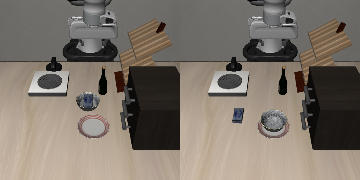

- **Agreement with the environment.** In every control step of every run, this
  runner's evaluation of the base task's goal equalled the environment's own
  `check_success()` (0 mismatches over all runs; the `mismatches` field of each table
  row).
- **Determinism.** On the same start, the jobs that share base task cheese-in-bowl (J1,
  J2, J6, J9, J10) reach step 1's native success at the same control step with the same
  simulator state hash, in every one of starts 0 to 9; J1 and J10 are the same run up
  to the end of their shared second step (their strips for start 1 are identical). A
  variant and naive on the same start are therefore identical up to the first switch,
  and the paired comparisons below are exact up to there.
- **Single skills on start 0** (one run each, the same end tail as every job):
  cheese in bowl, bowl on plate, bowl on stove, push plate, open middle drawer and bowl
  on cabinet delivered. Bowl in the top drawer timed out at 300 steps, still carrying
  the bowl. Turn on the stove reached native success at step 80 but still gripped the
  knob 60 steps later (fingers at 0.029 m), so it fails the release rule of the
  delivery check. The baseline spike had every goal-suite task at 9 or 10 of 10 by
  native success with LeRobot's own evaluator (`spikes/baseline/README.md`).

## 3. Naive chains on ten development starts

Every combination of the plan's table on starts 0 to 9, in the plan's order, then the
three-step job J10; the eight single skills on start 0 before them (protocol step 1).
Columns: N runs; **delivered** (the host-fixed end check) of N; per step, **native
reached** during the step / **native at end** of the job / **placed at end**, each of
N; held at switch (runs whose hand still held the step's object when the next
instruction began, of the runs that got there); the failure tags with counts; mean
control steps and wall-clock seconds per start.

| Job | Variant | N | Delivered | Per step: native reached / native at end / placed at end | Held at switch | Tags | Steps | s per start |
|---|---|---|---|---|---|---|---|---|
| S1 | naive | 1 | **0** | bowl in top drawer 0 / 0 / 0 | - | timeout 1 | 300 | 3.5 |
| S2 | naive | 1 | **0** | turn on stove 1 / 1 / 0 | - | other 1 | 140 | 1.8 |
| S3 | naive | 1 | **1** | bowl on cabinet 1 / 1 / 1 | - | delivered 1 | 103 | 1.4 |
| S4 | naive | 1 | **1** | bowl on plate 1 / 1 / 1 | - | delivered 1 | 93 | 1.3 |
| S6 | naive | 1 | **1** | cheese in bowl 1 / 1 / 1 | - | delivered 1 | 95 | 2.4 |
| S7 | naive | 1 | **1** | open middle drawer 1 / 1 / 1 | - | delivered 1 | 142 | 1.7 |
| S8 | naive | 1 | **1** | push plate 1 / 1 / 1 | - | delivered 1 | 179 | 2.2 |
| S9 | naive | 1 | **1** | bowl on stove 1 / 1 / 1 | - | delivered 1 | 105 | 1.4 |
| J1 | naive | 10 | **4** | cheese in bowl 10 / 9 / 9; bowl on plate 4 / 4 / 4 | 0/10 | second_skill_failed 5, delivered 4, item_tipped 1 | 310 | 4.0 |
| J2 | naive | 10 | **1** | cheese in bowl 10 / 9 / 8; bowl on stove 1 / 1 / 1 | 0/10 | second_skill_failed 8, item_tipped 1, delivered 1 | 376 | 4.7 |
| J3 | naive | 10 | **0** | bowl on plate 10 / 8 / 8; cheese in bowl 0 / 0 / 0 | 10/10 | target_moved 8, item_tipped 1, held_at_switch 1 | 377 | 4.6 |
| J4 | naive | 10 | **0** | push plate 9 / 3 / 2; bowl on plate 0 / 0 / 0 | 0/9 | item_tipped 6, target_moved 3, timeout 1 | 425 | 5.0 |
| J5 | naive | 10 | **0** | bowl on plate 10 / 3 / 2; push plate 0 / 0 / 0 | 10/10 | held_at_switch 6, second_skill_failed 2, item_tipped 2 | 377 | 5.0 |
| J6 | naive | 10 | **3** | cheese in bowl 10 / 9 / 7; bowl in top drawer 4 / 4 / 4 | 0/10 | second_skill_failed 6, delivered 3, item_tipped 1 | 359 | 4.6 |
| J7 | naive | 10 | **0** | turn on stove 10 / 6 / 5; bowl on stove 0 / 0 / 0 | 10/10 | second_skill_failed 5, held_at_switch 4, item_tipped 1 | 379 | 4.7 |
| J8 | naive | 10 | **0** | open middle drawer 10 / 10 / 1; bowl on plate 0 / 0 / 0 | 0/10 | second_skill_failed 10 | 422 | 5.0 |
| J9 | naive | 10 | **0** | cheese in bowl 10 / 10 / 6; bowl on cabinet 1 / 0 / 0 | 0/10 | second_skill_failed 9, item_tipped 1 | 392 | 5.2 |
| J10 | naive | 10 | **0** | cheese in bowl 10 / 8 / 7; bowl on plate 4 / 0 / 0; push plate 0 / 0 / 0 | 0/10, 4/4 | second_skill_failed 5, held_at_switch 3, item_tipped 2 | 420 | 5.3 |

Six-frame strips, one run of each combination's most common failure tag (scene
camera; start, mid step 1, the switch, 20 steps later, the failure, the end):

| Job | Strip |
|---|---|
| J1 cheese in bowl, bowl on plate | 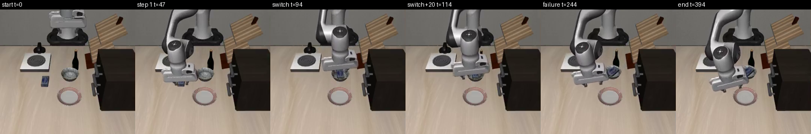 |
| J2 cheese in bowl, bowl on stove | 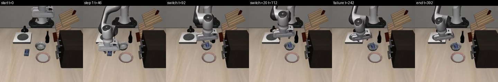 |
| J3 bowl on plate, cheese in bowl | 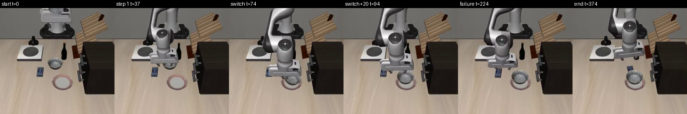 |
| J4 push plate, bowl on plate | 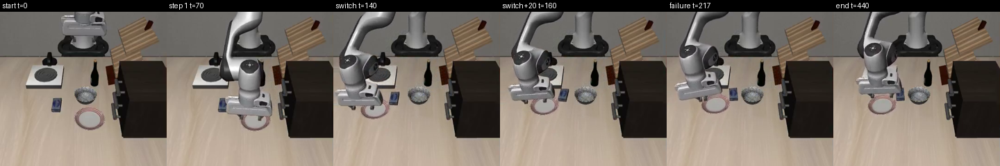 |
| J5 bowl on plate, push plate | 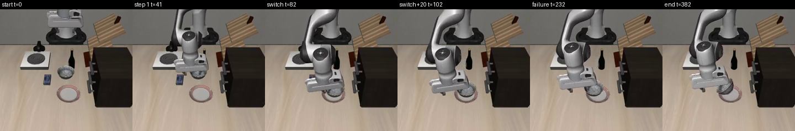 |
| J6 cheese in bowl, bowl in top drawer | 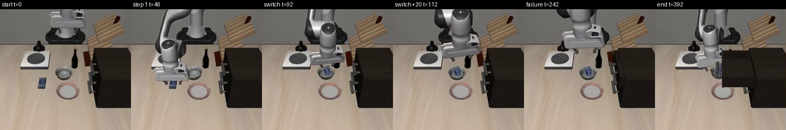 |
| J7 turn on stove, bowl on stove | 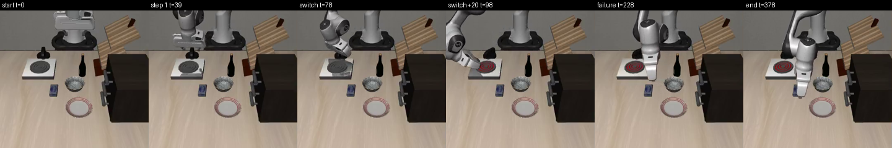 |
| J8 open middle drawer, bowl on plate | 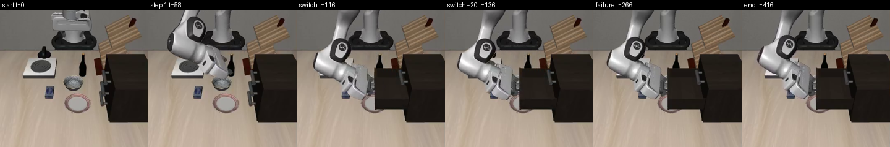 |
| J9 cheese in bowl, bowl on cabinet | 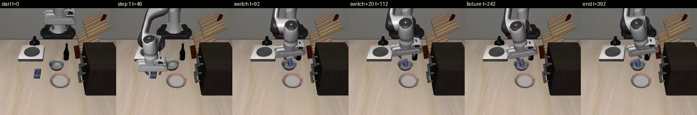 |
| J10 cheese in bowl, bowl on plate, push plate |  |

What the strips and traces show, per combination (counts of the ten naive runs unless
stated):

- **J1, J2, J6, J9 (the cheese first, then the loaded bowl).** The cheese step reaches
  native success on 10 of 10 everywhere, and the cheese is usually already let go when
  it does (gripper commanded open at 18 of the 20 J1 switches on starts 0 to 19, the
  hand touching the cheese at 5); not always: on J9's starts 10, 19 and 22 native
  success fires with the gripper commanded closed and in contact with the cheese
  (fingers 0.042 m apart). The bowl step then mostly fails without carrying anything:
  on J1's 20 naive starts the hand never comes within 8 cm of the bowl in 2, comes
  close but never lifts it (less than 2 cm) in 7, lifts it but never sets it on the
  plate in 5, and succeeds in 6.
- **J3 (the bowl first, then the cheese).** Native success of bowl-on-plate fires
  while the hand still holds the bowl (20 of 20 on starts 0 to 19). The policy then
  carries the cheese to where the bowl used to stand: of the 20 naive runs on starts
  0 to 19, 16 lift the cheese more than 5 cm, and 15 of those set it down nearer the
  bowl's starting place (1 to 9 cm from it) than the bowl itself (6 to 14 cm), so the
  cheese-in-bowl goal is never reached (0 of 20). The placed and release variants
  show the same (13 of 14 lifted runs each).
- **J4 (push the plate, then the bowl onto it).** The push reaches native success 9 of
  10; afterwards the hand stays at the plate, never comes within 8 cm of the bowl
  (9 of 9), and in 6 runs the plate leaves the stove-front region again.
- **J5 (the bowl onto the plate, then push the plate).** The hand still holds the bowl
  when the push begins (20 of 20 on starts 0 to 19) and drags bowl and plate together;
  the bowl ends tilted on the plate's rim.
- **J7 (turn on the stove, then the bowl onto it).** The hand still grips the knob at
  the switch (10 of 10); the bowl step never succeeds (0 of 10) and the stove is on at
  the end in only 6.
- **J8 (open the middle drawer, then the bowl onto the plate).** Independent steps,
  and still 0 of 10: from the open drawer the hand never comes within 8 cm of the bowl
  (10 of 10).
- **J10 (three steps).** The first two steps are J1's on the same starts (the same
  frames up to there). The push step runs on the four starts whose bowl step reached
  its goal (starts 0, 4, 6 and 7, all 300 steps), and the push goal is never achieved
  (0 of 10).

**Six spike-only pairs that share no object** (not in the plan's table; naive, starts
0 to 9), to find combinations that just work: K1 wine bottle on the rack, then bowl on
plate; K2 the reverse; K3 cheese in bowl, then wine on the rack; K4 wine on the rack,
then cheese in bowl; K5 turn on the stove, then open the middle drawer; K6 wine bottle
on top of the cabinet, then bowl on plate. Rows K1 to K6 of the table in section 4: K5
delivers 5 of 10, every other pair 0 of 10. In K1 and K4 native success of
wine-on-rack fires while the bottle is still in the hand (9 of 9 switches) and the
bottle is carried off the rack; in K6 the bottle falls off the cabinet afterwards (9 of
10). **No combination tested just works.**

## 4. Variants and confirmation runs

Protocol step 3 named two combinations; the first results (J1 and J2, 20 starts each)
showed no resolution, so the same variants were run on further combinations. All
counts are on starts 0 to 29 where N is 30, 0 to 19 where N is 20 and 0 to 9 where N
is 10; a variant and naive share their starts and are identical up to the first
switch (section 2).

| Job | Variant | N | Delivered | Per step: native reached / native at end / placed at end | Held at switch | Tags | Steps | s per start |
|---|---|---|---|---|---|---|---|---|
| J1 | naive | 20 | **5** | cheese in bowl 20 / 17 / 13; bowl on plate 6 / 6 / 5 | 2/20 | second_skill_failed 12, delivered 5, item_tipped 2, held_at_switch 1 | 332 | 4.5 |
| J1 | extend30 | 20 | **6** | cheese in bowl 20 / 15 / 12; bowl on plate 8 / 7 / 6 | 0/20 | second_skill_failed 7, item_tipped 6, delivered 6, other 1 | 340 | 4.4 |
| J1 | extend60 | 20 | **10** | cheese in bowl 20 / 18 / 13; bowl on plate 12 / 10 / 10 | 0/20 | delivered 10, second_skill_failed 6, item_tipped 4 | 331 | 4.3 |
| J1 | home | 20 | **0** | cheese in bowl 20 / 19 / 16; bowl on plate 0 / 0 / 0 | 0/20 | second_skill_failed 19, item_tipped 1 | 452 | 5.3 |
| J1 | placed | 20 | **10** | cheese in bowl 20 / 20 / 17; bowl on plate 12 / 11 / 10 | 0/20 | delivered 10, second_skill_failed 8, item_tipped 1, other 1 | 287 | 3.9 |
| J1 | placed-pickup | 20 | **7** | cheese in bowl 20 / 18 / 12; bowl on plate 12 / 12 / 10 | 0/20 | second_skill_failed 8, delivered 7, other 3, item_tipped 2 | 314 | 4.2 |
| J1 | release | 20 | **8** | cheese in bowl 20 / 17 / 13; bowl on plate 11 / 8 / 8 | 0/20 | delivered 8, second_skill_failed 6, item_tipped 6 | 355 | 4.4 |
| J1 | release-pickup | 20 | **5** | cheese in bowl 20 / 15 / 11; bowl on plate 7 / 6 / 5 | 0/20 | second_skill_failed 8, item_tipped 6, delivered 5, other 1 | 396 | 5.0 |
| J1 | retry | 20 | **9** | cheese in bowl 20 / 19 / 17; bowl on plate 11 / 10 / 9 | 0/20 | delivered 9, second_skill_failed 8, item_tipped 2, other 1 | 313 | 4.1 |
| J1 | teleport | 20 | **1** | cheese in bowl 20 / 19 / 17; bowl on plate 1 / 1 / 1 | 0/20 | second_skill_failed 18, delivered 1, item_tipped 1 | 396 | 4.9 |
| J2 | naive | 20 | **1** | cheese in bowl 20 / 17 / 16; bowl on stove 2 / 2 / 2 | 2/20 | second_skill_failed 16, held_at_switch 2, item_tipped 1, delivered 1 | 376 | 4.8 |
| J2 | extend30 | 20 | **8** | cheese in bowl 20 / 17 / 16; bowl on stove 10 / 10 / 8 | 0/20 | second_skill_failed 8, delivered 8, item_tipped 3, other 1 | 323 | 4.1 |
| J2 | extend60 | 20 | **7** | cheese in bowl 20 / 19 / 19; bowl on stove 7 / 7 / 7 | 0/20 | second_skill_failed 12, delivered 7, item_tipped 1 | 373 | 4.7 |
| J2 | home | 20 | **2** | cheese in bowl 20 / 18 / 16; bowl on stove 3 / 3 / 2 | 0/20 | second_skill_failed 16, item_tipped 2, delivered 2 | 438 | 5.1 |
| J2 | placed | 20 | **6** | cheese in bowl 20 / 20 / 20; bowl on stove 6 / 6 / 6 | 0/20 | second_skill_failed 14, delivered 6 | 344 | 4.4 |
| J2 | release | 20 | **8** | cheese in bowl 20 / 15 / 12; bowl on stove 11 / 9 / 8 | 0/20 | delivered 8, item_tipped 7, second_skill_failed 4, other 1 | 327 | 3.9 |
| J2 | retry | 20 | **6** | cheese in bowl 20 / 20 / 19; bowl on stove 6 / 6 / 6 | 0/20 | second_skill_failed 14, delivered 6 | 379 | 4.7 |
| J2 | teleport | 20 | **2** | cheese in bowl 20 / 18 / 18; bowl on stove 3 / 3 / 2 | 0/20 | second_skill_failed 16, delivered 2, item_tipped 2 | 377 | 4.9 |
| J3 | naive | 20 | **0** | bowl on plate 20 / 17 / 15; cheese in bowl 0 / 0 / 0 | 20/20 | target_moved 17, item_tipped 2, held_at_switch 1 | 377 | 4.9 |
| J3 | placed | 20 | **0** | bowl on plate 20 / 20 / 19; cheese in bowl 0 / 0 / 0 | 0/20 | target_moved 20 | 388 | 5.6 |
| J3 | release | 20 | **0** | bowl on plate 20 / 16 / 16; cheese in bowl 0 / 0 / 0 | 0/20 | target_moved 16, item_tipped 4 | 427 | 6.0 |
| J4 | naive | 10 | **0** | push plate 9 / 3 / 2; bowl on plate 0 / 0 / 0 | 0/9 | item_tipped 6, target_moved 3, timeout 1 | 425 | 5.0 |
| J4 | home | 10 | **5** | push plate 9 / 5 / 5; bowl on plate 8 / 8 / 6 | 0/9 | delivered 5, item_tipped 4, timeout 1 | 380 | 4.3 |
| J4 | placed | 10 | **0** | push plate 9 / 7 / 4; bowl on plate 0 / 0 / 0 | 0/9 | target_moved 7, item_tipped 2, timeout 1 | 460 | 5.6 |
| J4 | release | 10 | **0** | push plate 9 / 0 / 0; bowl on plate 0 / 0 / 0 | 0/9 | item_tipped 9, timeout 1 | 470 | 5.6 |
| J5 | naive | 20 | **0** | bowl on plate 20 / 8 / 3; push plate 0 / 0 / 0 | 20/20 | held_at_switch 14, second_skill_failed 4, item_tipped 2 | 377 | 5.0 |
| J5 | placed | 20 | **0** | bowl on plate 20 / 9 / 5; push plate 0 / 0 / 0 | 0/20 | item_tipped 11, second_skill_failed 9 | 388 | 5.0 |
| J5 | release | 20 | **0** | bowl on plate 20 / 9 / 6; push plate 0 / 0 / 0 | 0/20 | item_tipped 11, second_skill_failed 9 | 427 | 5.2 |
| J6 | naive | 10 | **3** | cheese in bowl 10 / 9 / 7; bowl in top drawer 4 / 4 / 4 | 0/10 | second_skill_failed 6, delivered 3, item_tipped 1 | 359 | 4.6 |
| J6 | extend30 | 10 | **0** | cheese in bowl 10 / 8 / 4; bowl in top drawer 1 / 1 / 0 | 0/10 | second_skill_failed 8, item_tipped 2 | 426 | 5.3 |
| J6 | placed | 10 | **4** | cheese in bowl 10 / 9 / 8; bowl in top drawer 4 / 4 / 4 | 0/10 | second_skill_failed 5, delivered 4, item_tipped 1 | 376 | 5.0 |
| J6 | release | 10 | **2** | cheese in bowl 10 / 8 / 7; bowl in top drawer 2 / 2 / 2 | 0/10 | second_skill_failed 6, item_tipped 2, delivered 2 | 438 | 5.4 |
| J7 | naive | 10 | **0** | turn on stove 10 / 6 / 5; bowl on stove 0 / 0 / 0 | 10/10 | second_skill_failed 5, held_at_switch 4, item_tipped 1 | 379 | 4.7 |
| J7 | home | 10 | **3** | turn on stove 10 / 3 / 3; bowl on stove 6 / 4 / 4 | 0/10 | item_tipped 7, delivered 3 | 385 | 4.4 |
| J7 | placed | 10 | **0** | turn on stove 10 / 8 / 6; bowl on stove 0 / 0 / 0 | 5/10 | second_skill_failed 6, held_at_switch 2, item_tipped 2 | 438 | 5.7 |
| J7 | release | 10 | **0** | turn on stove 10 / 1 / 1; bowl on stove 1 / 1 / 1 | 0/10 | item_tipped 9, second_skill_failed 1 | 430 | 5.2 |
| J8 | naive | 10 | **0** | open middle drawer 10 / 10 / 1; bowl on plate 0 / 0 / 0 | 0/10 | second_skill_failed 10 | 422 | 5.0 |
| J8 | home | 10 | **0** | open middle drawer 10 / 0 / 0; bowl on plate 0 / 0 / 0 | 0/10 | item_tipped 10 | 490 | 5.6 |
| J8 | placed | 10 | **0** | open middle drawer 10 / 10 / 0; bowl on plate 0 / 0 / 0 | 0/10 | second_skill_failed 10 | 441 | 5.2 |
| J8 | release | 10 | **0** | open middle drawer 10 / 10 / 0; bowl on plate 0 / 0 / 0 | 0/10 | second_skill_failed 10 | 472 | 5.4 |
| J8 | teleport | 10 | **0** | open middle drawer 10 / 3 / 1; bowl on plate 0 / 0 / 0 | 0/10 | item_tipped 7, second_skill_failed 3 | 432 | 5.3 |
| J9 | naive | 30 | **2** | cheese in bowl 30 / 25 / 16; bowl on cabinet 4 / 3 / 2 | 3/30 | second_skill_failed 22, item_tipped 4, held_at_switch 2, delivered 2 | 383 | 4.9 |
| J9 | extend15 | 30 | **9** | cheese in bowl 30 / 22 / 19; bowl on cabinet 12 / 12 / 10 | 0/30 | second_skill_failed 13, delivered 9, item_tipped 8 | 348 | 4.5 |
| J9 | extend30 | 30 | **20** | cheese in bowl 30 / 23 / 21; bowl on cabinet 25 / 23 / 21 | 0/30 | delivered 20, item_tipped 8, second_skill_failed 2 | 276 | 3.6 |
| J9 | extend45 | 30 | **16** | cheese in bowl 30 / 22 / 21; bowl on cabinet 21 / 18 / 18 | 7/30 | delivered 16, item_tipped 8, second_skill_failed 5, held_at_switch 1 | 308 | 4.1 |
| J9 | extend60 | 30 | **22** | cheese in bowl 30 / 29 / 27; bowl on cabinet 24 / 23 / 23 | 0/30 | delivered 22, second_skill_failed 6, item_tipped 2 | 299 | 4.0 |
| J9 | placed | 20 | **6** | cheese in bowl 20 / 17 / 14; bowl on cabinet 6 / 6 / 6 | 0/20 | second_skill_failed 11, delivered 6, item_tipped 3 | 364 | 4.7 |
| J9 | release | 20 | **10** | cheese in bowl 20 / 17 / 11; bowl on cabinet 14 / 12 / 11 | 0/20 | delivered 10, item_tipped 5, second_skill_failed 5 | 338 | 4.2 |
| J10 | naive | 10 | **0** | cheese in bowl 10 / 8 / 7; bowl on plate 4 / 0 / 0; push plate 0 / 0 / 0 | 0/10, 4/4 | second_skill_failed 5, held_at_switch 3, item_tipped 2 | 420 | 5.3 |
| J10 | extend30 | 10 | **0** | cheese in bowl 10 / 5 / 3; bowl on plate 4 / 1 / 0; push plate 0 / 0 / 0 | 0/10, 0/4 | item_tipped 7, second_skill_failed 3 | 461 | 6.1 |
| J10 | placed | 10 | **0** | cheese in bowl 10 / 7 / 4; bowl on plate 7 / 1 / 1; push plate 0 / 0 / 0 | 0/10, 0/7 | item_tipped 6, second_skill_failed 4 | 477 | 6.4 |
| J10 | release | 10 | **0** | cheese in bowl 10 / 7 / 3; bowl on plate 6 / 1 / 0; push plate 0 / 0 / 0 | 0/10, 0/6 | item_tipped 6, second_skill_failed 4 | 547 | 7.1 |
| K1 | naive | 20 | **0** | wine on rack 19 / 1 / 0; bowl on plate 0 / 0 / 0 | 18/19 | held_at_switch 16, item_tipped 3, timeout 1 | 424 | 5.3 |
| K1 | home | 10 | **0** | wine on rack 9 / 9 / 9; bowl on plate 0 / 0 / 0 | 0/9 | second_skill_failed 9, timeout 1 | 470 | 5.8 |
| K1 | placed | 20 | **0** | wine on rack 19 / 1 / 0; bowl on plate 0 / 0 / 0 | 0/19 | item_tipped 18, timeout 1, second_skill_failed 1 | 445 | 5.6 |
| K1 | release | 20 | **0** | wine on rack 19 / 2 / 2; bowl on plate 0 / 0 / 0 | 0/19 | item_tipped 17, second_skill_failed 2, timeout 1 | 472 | 5.6 |
| K2 | naive | 10 | **0** | bowl on plate 10 / 10 / 10; wine on rack 0 / 0 / 0 | 10/10 | second_skill_failed 10 | 377 | 4.7 |
| K3 | naive | 10 | **0** | cheese in bowl 10 / 10 / 10; wine on rack 0 / 0 / 0 | 0/10 | second_skill_failed 10 | 391 | 5.0 |
| K4 | naive | 20 | **0** | wine on rack 19 / 0 / 0; cheese in bowl 0 / 0 / 0 | 18/19 | held_at_switch 16, item_tipped 3, timeout 1 | 424 | 5.3 |
| K4 | home | 10 | **0** | wine on rack 9 / 9 / 9; cheese in bowl 0 / 0 / 0 | 0/9 | second_skill_failed 9, timeout 1 | 470 | 5.6 |
| K4 | placed | 20 | **0** | wine on rack 19 / 0 / 0; cheese in bowl 0 / 0 / 0 | 0/19 | item_tipped 19, timeout 1 | 445 | 5.5 |
| K4 | release | 20 | **0** | wine on rack 19 / 0 / 0; cheese in bowl 0 / 0 / 0 | 0/19 | item_tipped 19, timeout 1 | 472 | 5.6 |
| K5 | naive | 10 | **5** | turn on stove 10 / 8 / 7; open middle drawer 7 / 7 / 7 | 10/10 | delivered 5, held_at_switch 3, item_tipped 1, second_skill_failed 1 | 348 | 4.2 |
| K5 | placed | 10 | **4** | turn on stove 10 / 8 / 8; open middle drawer 7 / 7 / 4 | 5/10 | delivered 4, second_skill_failed 3, item_tipped 2, other 1 | 409 | 5.0 |
| K5 | release | 10 | **0** | turn on stove 10 / 0 / 0; open middle drawer 5 / 5 / 3 | 0/10 | item_tipped 10 | 446 | 5.1 |
| K6 | naive | 10 | **0** | wine on cabinet 10 / 1 / 1; bowl on plate 0 / 0 / 0 | 9/10 | item_tipped 9, second_skill_failed 1 | 389 | 4.7 |
| K6 | home | 10 | **0** | wine on cabinet 10 / 1 / 1; bowl on plate 2 / 2 / 2 | 0/10 | item_tipped 9, second_skill_failed 1 | 448 | 5.2 |
| K6 | placed | 10 | **2** | wine on cabinet 10 / 5 / 5; bowl on plate 4 / 4 / 3 | 0/10 | item_tipped 5, second_skill_failed 3, delivered 2 | 364 | 4.6 |
| K6 | release | 10 | **0** | wine on cabinet 10 / 0 / 0; bowl on plate 6 / 5 / 4 | 0/10 | item_tipped 10 | 379 | 4.4 |
| K7 | naive | 10 | **0** | bowl on cabinet 10 / 9 / 9; cheese in bowl 0 / 0 / 0 | 10/10 | target_moved 9, item_tipped 1 | 391 | 4.8 |
| K7 | extend30 | 10 | **0** | bowl on cabinet 10 / 0 / 0; cheese in bowl 1 / 1 / 0 | 0/10 | item_tipped 10 | 422 | 5.3 |

**Paired against naive on the same starts** (rescued: naive not delivered, variant
delivered; broken: the reverse; start numbers in brackets):

| Job | Variant | Same starts | Naive delivered | Variant delivered | Rescued | Broken |
|---|---|---|---|---|---|---|
| J1 | extend30 | 20 | 5 | 6 | 3 (10, 13, 16) | 2 (0, 18) |
| J1 | extend60 | 20 | 5 | 10 | 5 (1, 10, 13, 14, 17) | 0 (none) |
| J1 | home | 20 | 5 | 0 | 0 (none) | 5 (0, 4, 6, 7, 18) |
| J1 | placed | 20 | 5 | 10 | 5 (2, 5, 10, 13, 14) | 0 (none) |
| J1 | placed-pickup | 20 | 5 | 7 | 5 (3, 5, 10, 13, 14) | 3 (4, 6, 7) |
| J1 | release | 20 | 5 | 8 | 4 (1, 2, 13, 14) | 1 (7) |
| J1 | release-pickup | 20 | 5 | 5 | 4 (2, 13, 17, 19) | 4 (0, 4, 6, 18) |
| J1 | retry | 20 | 5 | 9 | 4 (5, 10, 13, 14) | 0 (none) |
| J1 | teleport | 20 | 5 | 1 | 0 (none) | 4 (4, 6, 7, 18) |
| J2 | extend30 | 20 | 1 | 8 | 8 (2, 4, 8, 9, 13, 15, 17, 19) | 1 (6) |
| J2 | extend60 | 20 | 1 | 7 | 7 (0, 8, 9, 13, 15, 16, 17) | 1 (6) |
| J2 | home | 20 | 1 | 2 | 1 (8) | 0 (none) |
| J2 | placed | 20 | 1 | 6 | 5 (5, 7, 12, 14, 19) | 0 (none) |
| J2 | release | 20 | 1 | 8 | 7 (1, 2, 4, 8, 9, 13, 19) | 0 (none) |
| J2 | retry | 20 | 1 | 6 | 5 (5, 7, 12, 14, 19) | 0 (none) |
| J2 | teleport | 20 | 1 | 2 | 2 (3, 8) | 1 (6) |
| J3 | placed | 20 | 0 | 0 | 0 (none) | 0 (none) |
| J3 | release | 20 | 0 | 0 | 0 (none) | 0 (none) |
| J4 | home | 10 | 0 | 5 | 5 (0, 2, 6, 8, 9) | 0 (none) |
| J4 | placed | 10 | 0 | 0 | 0 (none) | 0 (none) |
| J4 | release | 10 | 0 | 0 | 0 (none) | 0 (none) |
| J5 | placed | 20 | 0 | 0 | 0 (none) | 0 (none) |
| J5 | release | 20 | 0 | 0 | 0 (none) | 0 (none) |
| J6 | extend30 | 10 | 3 | 0 | 0 (none) | 3 (2, 3, 8) |
| J6 | placed | 10 | 3 | 4 | 2 (5, 9) | 1 (2) |
| J6 | release | 10 | 3 | 2 | 0 (none) | 1 (2) |
| J7 | home | 10 | 0 | 3 | 3 (3, 4, 5) | 0 (none) |
| J7 | placed | 10 | 0 | 0 | 0 (none) | 0 (none) |
| J7 | release | 10 | 0 | 0 | 0 (none) | 0 (none) |
| J8 | home | 10 | 0 | 0 | 0 (none) | 0 (none) |
| J8 | placed | 10 | 0 | 0 | 0 (none) | 0 (none) |
| J8 | release | 10 | 0 | 0 | 0 (none) | 0 (none) |
| J8 | teleport | 10 | 0 | 0 | 0 (none) | 0 (none) |
| J9 | extend15 | 30 | 2 | 9 | 8 (1, 2, 3, 6, 14, 15, 21, 27) | 1 (25) |
| J9 | extend30 | 30 | 2 | 20 | 19 (0, 1, 2, 3, 4, 5, 6, 8, 9, 10, 12, 16, 17, 18, 20, 21, 22, 24, 27) | 1 (23) |
| J9 | extend45 | 30 | 2 | 16 | 15 (3, 5, 6, 7, 8, 9, 12, 14, 15, 19, 21, 22, 24, 27, 29) | 1 (23) |
| J9 | extend60 | 30 | 2 | 22 | 20 (0, 1, 4, 7, 8, 11, 12, 13, 15, 16, 17, 18, 19, 20, 22, 24, 26, 27, 28, 29) | 0 (none) |
| J9 | placed | 20 | 0 | 6 | 6 (1, 2, 3, 5, 9, 10) | 0 (none) |
| J9 | release | 20 | 0 | 10 | 10 (1, 2, 4, 5, 6, 8, 10, 12, 17, 19) | 0 (none) |
| J10 | extend30 | 10 | 0 | 0 | 0 (none) | 0 (none) |
| J10 | placed | 10 | 0 | 0 | 0 (none) | 0 (none) |
| J10 | release | 10 | 0 | 0 | 0 (none) | 0 (none) |
| K1 | home | 10 | 0 | 0 | 0 (none) | 0 (none) |
| K1 | placed | 20 | 0 | 0 | 0 (none) | 0 (none) |
| K1 | release | 20 | 0 | 0 | 0 (none) | 0 (none) |
| K4 | home | 10 | 0 | 0 | 0 (none) | 0 (none) |
| K4 | placed | 20 | 0 | 0 | 0 (none) | 0 (none) |
| K4 | release | 20 | 0 | 0 | 0 (none) | 0 (none) |
| K5 | placed | 10 | 5 | 4 | 4 (0, 4, 6, 9) | 5 (1, 3, 5, 7, 8) |
| K5 | release | 10 | 5 | 0 | 0 (none) | 5 (1, 3, 5, 7, 8) |
| K6 | home | 10 | 0 | 0 | 0 (none) | 0 (none) |
| K6 | placed | 10 | 0 | 2 | 2 (4, 7) | 0 (none) |
| K6 | release | 10 | 0 | 0 | 0 (none) | 0 (none) |
| K7 | extend30 | 10 | 0 | 0 | 0 (none) | 0 (none) |

**What the variants show**, by kind of difficulty (counts from the tables above; a
95% Wilson interval where a count rests on at least 20 starts):

- **The loaded carry: the cheese first, then the bowl (J1, J2, J6, J9).** Switching
  later lets the policy grasp the loaded bowl more often; nothing tried makes it
  reliable. J9: naive 2 of 30 (7%, 2 to 21%), `extend30` 20 of 30 (67%, 49 to 81%;
  19 rescued, 1 broken), `release` 10 of 20, `placed` 6 of 20. J1: naive 5 of 20
  (25%, 11 to 47%), `placed` and `extend60` 10 of 20 each (50%, 30 to 70%; 5 rescued,
  none broken), `retry` 9, `release` 8, `extend30` 6. J2: naive 1 of 20 (5%, 1 to
  24%), `release` and `extend30` 8 of 20 (40%, 22 to 61%), `extend60` 7, `placed` 6.
  J6: naive 3 of 10, `placed` 4, `release` 2, `extend30` 0. A later switch changes
  where the hand is when the bowl step begins (mean height above the bowl): on J9 8.1
  cm at a naive switch on starts 0 to 9 (6.6 to 10.3; 7.8 over all 30), 12.9 cm after
  30 more steps of the cheese skill (30 runs; 13.0 on J1's 20) and 12.9 cm after the
  release's lift (20 runs), but 10.6 cm after 60 more steps (30 runs), the best
  variant; so the height does not explain `extend60`, and height as the cause is
  unverified. From the higher start J1's bowl is lifted in 18 of 20 runs (`extend30`)
  against 11 of 20 naive. What remains differs by variant. On J9 with `extend30` (10
  failures of 30) the bowl step times out in 5 and reaches its goal in 5; the cheese is
  out of the bowl at the end in 7, lost 24 to 285 control steps into the bowl step
  (knocked out by the hand in 5, as the bowl moved in 2), never during the extra steps;
  the bowl is off the cabinet at the end in 7 (4 runs lose both). On J9 with `extend60`
  (8 failures) the bowl step times out in 6, with the cheese still in the bowl; of the
  two that reach the bowl goal, start 9 loses the bowl from the cabinet and start 10
  the cheese. Tags count each run once, by the first lost goal in program order
  (`extend30`: `item_tipped` 8, `second_skill_failed` 2; `extend60`:
  `second_skill_failed` 6, `item_tipped` 2), so they are not the same as step outcomes.
  On J1, `extend30` lifts the bowl in 10 of 20 runs and never places it. Starting the
  bowl step from the job's start pose makes it worse: J1 `home` 0 of 20 and `teleport`
  1 of 20. In every one of those runs the hand reaches the loaded bowl and the gripper
  closes on it, but the bowl is lifted less than 2 cm in 19 and 15 of 20; why the grasp
  does not hold is unverified. A second attempt (`retry`, J1 9 and J2 6 of 20) and a
  rephrased instruction (J1 7 and 5 of 20) do not help; the failures repeat.
- **The moved target (J3, K7).** No variant changes where the policy puts the cheese:
  J3 0 of 20 in naive, `placed` and `release` (0 to 16%); K7, J9 in reverse (the bowl
  on the cabinet, then the cheese in it), 0 of 10 naive (the cheese goes where the bowl
  stood, 9 of 10) and 0 of 10 with `extend30`.
- **The hand still holds the object (J5, J7, K1, K4).** Switching on placed or
  releasing first removes the hold and exposes the next failure: J5 0 of 20 in naive,
  `placed` and `release` (the released bowl slides off the pushed plate in 11 of 20);
  J7 0 of 10 in naive, `placed` and `release` (letting go of the knob turns the stove
  off: on at the end in 1 of 10 after the release); K1 and K4 0 of 20 in naive,
  `placed` and `release` (the bottle falls off the rack once let go or knocked, 17 to
  19 of 20).
- **The hand left far from the next object, or a changed scene (J4, J7, J8, K1, K4).**
  This spike's return of the hand to the start helps where the rest of the scene is
  ordinary: J4 0 to 5 of 10 (5 rescued, none broken), J7 0 to 3 of 10. It took 14 to
  17 one-axis ramps of 5 cm; lane J's `home` step moves differently, so whether it
  does the same is unverified (section 7, item 6). It does not help when the
  first skill changed the scene: J8 0 of 10 in all five variants, the arm put back
  included (the open middle drawer defeats bowl-on-plate), and K1 and K4 `home` 0 of 10
  with the bottle staying on the rack in 9 of 9 (the next skill fails in 9 of 9).
- **Three steps (J10)**: 0 of 10 in naive, `placed`, `release` and `extend30`: J1's
  difficulty, then the push of a loaded plate (J5's).

**How long to let the first skill run on (J9, starts 0 to 29, N = 30 each).** After
native success of the cheese step, a second policy step under the same instruction for
15, 30, 45 or 60 control steps, then the bowl step: delivered 9, 20, 16 and 22 of 30
(rescued 8, 19, 15 and 20; broken 1, 1, 1 and 0 against naive's 2 of 30). The best,
`extend60`, is 73% (95% interval 56 to 86%). The response to the length is not
monotone, so a single length found on a few starts may not hold on others: on starts 0
to 9 alone `extend30` delivered 9 of 10, on starts 10 to 29 it delivered 11 of 20.

Strips of variant failures: J1 with the placed switch (the loaded bowl not grasped),
J9 with `extend30` (the commonest residual failure), J3 with the release (the cheese
set down where the bowl stood), K1 with the release (the bottle falls off the rack):

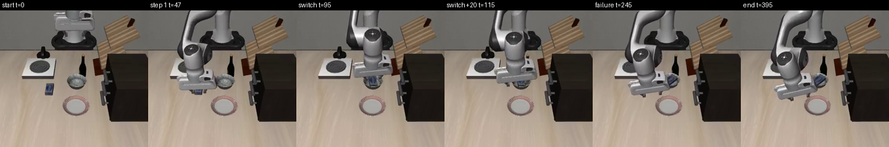
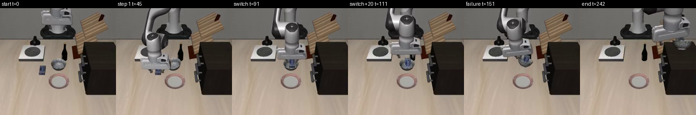
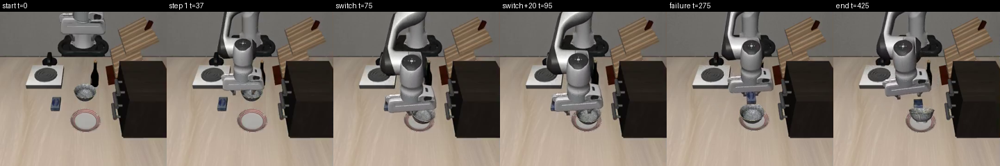
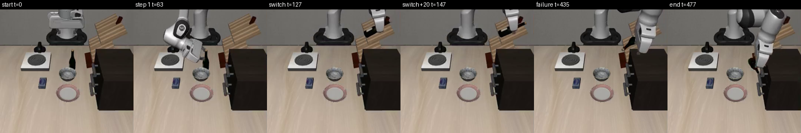

## 5. Throughput

| Quantity, over the chained runs | Value |
|---|---|
| chained runs | 1130 |
| seconds per chained start (wall clock, video included) | mean 4.9, median 5.2, 5th to 95th percentile 2.8 to 6.1, at most 9.2 |
| milliseconds per policy call (batch 1, fp16_res32; a run's mean) | mean 137, median 135, 95th percentile 149, at most 260 |
| policy calls per start | mean 13.0, at most 22 |
| control steps per start | mean 387, at most 700 |
| milliseconds of simulation per control step (physics, two cameras at 360 pixels, privileged state, every goal) | mean 6.5 |
| share of wall clock in policy calls | 37% |
| one-minute load average at run starts | 1.7 to 13.1, median 3.6 |

What this means for the demo's budgets (sequential, one GPU job, video on):
20 starts take about 1.7 minutes of queue, a session of four requests of 20 starts
about 7 minutes, and an investigation's ceiling of 400 starts about 33 minutes, plus
about 10 to 20 s to load the policy per batch. Policy calls are about a third of the
time; rendering two cameras at 360 pixels and writing the video are most of the rest.
A run without video, or a worker pool, would be faster; neither was measured here.

## 6. Recommendation for gate 1

1. **Which branch of gate 1.** No program delivered on four fifths of its starts
   (the plan's acceptance level) for any combination. The nearest is J9 with a
   60-step continuation, 22 of 30 (73%, 95% interval 56 to 86%). If its rate held, a
   release of 20 fresh starts with at least 16 delivered would pass with probability
   about 0.35 (binomial); a bar of 12 of 20 about 0.94. At J1's best (50%) the chance
   of 16 of 20 is about 0.01. Story A can show a real, legible difficulty and a
   measured, paired improvement found inside the vocabulary; it cannot yet show a
   released job at the plan's bar. That is the gate's "nothing resolves" branch unless
   the bar or the vocabulary changes, which is the integrator's call,
   not this spike's.
2. **Job one: J9, cheese in the bowl, then the bowl on top of the cabinet.** The
   starkest difficulty with the largest gain: naive 2 of 30. Native success of the
   cheese step fires the moment the cheese touches the bowl (usually already let go),
   with the hand about 8 cm above it; the bowl step then times out in 26 of 30 (22 of
   those runs carry the tag `second_skill_failed`). The fix is legible: let the first
   skill finish before switching, a policy step `until: steps N` under the same
   instruction (20 of 30 at 30 steps, 22 of 30 at 60; release and retreat 10 of 20;
   the placed switch 6 of 20). Why it helps is not established (the switch height
   rises with 30 steps but less with 60). What remains differs by length: at 60 steps
   6 of the 8 failures are bowl-step timeouts with the cheese still in the bowl, one
   loses the bowl from the cabinet and one the cheese; at 30 steps the cheese ends
   out of the bowl in 7 of the 10 failures and the bowl step times out in 5.
3. **Job two: J1, cheese in the bowl, then the bowl on the plate** (the plan's primary
   candidate). Same interaction class, its own difficulty: the method transfers only
   partly. J1 goes from 5 to 10 of 20 with the placed switch or a 60-step continuation
   (5 rescued, none broken each), but the 30-step continuation that serves J9 gives
   only 6 of 20, and the bowl is often lifted and never set on the plate. J2, the
   bowl on the stove (1 to 8 of 20 with release or a 30-step continuation), is the
   alternative.
4. **The order the rule should forbid.** The plan's example rule, the item goes in
   before the container moves, allows J9, J1 and J2 and forbids K7 and J3 (the
   container first). Those never work: 0 of 10 and 0 of 20 in every variant tried,
   because the policy sets the cheese down where the bowl used to stand. So the rule
   forbids an order that does not avoid the difficulty; it costs the agent nothing.
   Keep it as the stated packing-rule analogue, checked on the traces, and do not say
   it forced the harder order. Of the pairs run in both orders (J1 and J3, J4 and J5,
   J9 and K7, K1 and K2, K3 and K4), none has an order that works, so no order rule
   can bite on these tasks.
5. **Combinations that just work: none.** The best naive results are K5 (stove, then
   drawer) 5 of 10 and J1 5 of 20. The film's opener should be the single skills: 6 of
   8 delivered on start 0 with this runner, and 99 of 100 by native success in the
   baseline spike.
6. **Throughput for the budgets.** About 5 s per chained start (4.9 mean, 2.8 to 6.1
   for the middle 90%), 137 ms per policy call on average (149 at the 95th
   percentile), under a one-minute load average of 1.7 to 13.1. 20 starts take about
   1.7 minutes of queue, four requests of 20 about 7 minutes, 400 starts about 33
   minutes. The plan's ceilings fit easily.

## 7. Findings for the integrator (outside `spikes/jobs/`)

1. **Two task numberings.** The plan numbers tasks in `tasks_info.txt` order;
   `LiberoEnv` and `LiberoSimEnv(suite, task_index)` and the per-task table in
   `spikes/baseline/README.md` use LIBERO's benchmark order
   (`benchmark/libero_suite_task_map.py`, `task_order_index` 0). Plan number to
   benchmark index: 0→2, 1→3, 2→7, 3→4, 4→8, 5→9, 6→6, 7→0, 8→5, 9→1 (only 6, cheese
   in bowl, agrees). Lane J should resolve steps by BDDL name, never by index.
2. **`build_index` refuses the unary goals** (`src/fleetlab/sim/libero_sim.py`): it
   unpacks three elements of the goal predicate, so `LiberoSimEnv` cannot be built for
   turn-on-the-stove (plan 2) or open-the-middle-drawer (plan 7), the base tasks of J7,
   J8 and K5. The spike builds the scene index with the argument repeated
   (`runner.make_env`); a fix in `build_index` would accept a two-element predicate
   and leave `target_body` empty. Also: for push-the-plate, the target is a region of
   the table, whose `parent_name` is None, so `env.goal.target_body` is None there.
3. **The cheese goal is `On`, not `In`.** The plan's example requested goal "In
   cream_cheese akita_black_bowl" is `On cream_cheese_1 akita_black_bowl_1` in the BDDL;
   the only `In` goal in the suite is the bowl in the top drawer. Requested goals should
   be copied from the BDDL files.
4. **How a job ends.** X-VLA still touches or holds the object when native success
   fires, so a program that ends at its last step's native success fails the delivery
   check almost always. This spike ends every job with up to 60 steps under the last
   instruction until the delivery check holds. The jobs runtime needs an explicit end
   (for example a final "until delivered" stop condition or a tail), or the delivered
   rate measures the last step's release, not the job.
5. **The stove knob.** Turn-on-the-stove alone keeps gripping the knob after the stove
   is on (start 0: still closed on it 60 steps later), so it fails the release rule;
   and opening the hand on the knob turns the stove back off in most runs (J7 release:
   the stove is on at the end in 1 of 10).
6. **Returning the hand: re-measure with the contract's `home`.** At a switch the hand
   is 20 to 43 cm from where the job started. Lane J's contract now has a `home` step
   (`0c00b85`: a straight ramp to the start pose, orientation included, up to 0.5 m/s,
   gripper open, then settling within 1 cm and at rest, at most 200 steps). This
   spike's `home` was a different motion (open and hold 10 steps, then 8 to 17
   one-axis ramps of 5 cm, z then x then y, at 0.2 m/s, the orientation held), so its
   results (J4 0 to 5 of 10, J7 0 to 3 of 10, J1 5 to 0 of 20, J8 0 of 10) are
   unverified for the contract's step and should be measured again with it.
7. **Retries.** `on_timeout: continue` makes a second attempt a program (a repeated
   policy step). The retry measured here (J1 9 of 20, J2 6 of 20) switched on placed,
   which the contract cannot express, so no expressible retry has been measured; one
   after a naive or `until: steps N` switch was not run.
8. **Step budget.** Bowl-into-the-top-drawer timed out at 300 steps on start 0 while
   still carrying the bowl; it is J6's second step. 300 per step may be tight for it.
9. **Resumable runs.** The harness stopped a background batch at its 30-minute limit,
   which counted the wait for the heavy lock; the runner's `--resume` (skip runs with a
   summary) made the restart cheap. The jobs runtime's batch runner should resume the
   same way.
10. **Determinism and pairing.** With batch size 1 and the pinned database, the same
    start gives the same state at step 1's native success across jobs and variants, so
    variant and naive differ only after the switch; the rescued and broken counts are
    exact pairs.

## 8. What did not run, and limits

- Starts 30 to 49 (reserved for release runs) were not used; starts 20 to 29 only for J9.
- Thirty starts ran for J9 (naive and the four continuation lengths), twenty for J1,
  J2, J3, J5, K1 and K4 and for J9's placed and release; everything else ran on ten.
  Counts on ten starts carry no interval here; the paired counts are literal.
- J9's best length (60 steps) was chosen on the same 30 starts it is reported on; its
  rate on fresh starts is untested and may be lower.
- The transitions were not tuned beyond the continuation length: one release (15 +
  20 + 15 steps), one home move (not the contract's `home`), one retry schedule, one
  rephrased instruction, four
  continuation lengths (15 to 60 steps). Combinations of them were not tried.
- Whether the loaded-bowl grasp fails because the cheese blocks the fingers or because
  the policy does not recognise a loaded bowl was not separated (a visual-only change of
  the cheese would tell).
- Single skills ran once each with this runner (start 0); the baseline spike's 9 or 10
  of 10 per task used LeRobot's evaluator and seed 1000, not these starts.
- No run was repeated in a second process; determinism was checked within a batch by
  state hashes.
- Wall-clock times are under the load stated in section 1; video encoding is included.

## 9. Reproduce

```sh
cd ~/code/robots-wt-spike   # branch demo/spike
export FLEETLAB_MIOPEN_DIR=$HOME/.cache/robots-probes/engine/miopen TMPDIR=/var/tmp/robots-spike
OUT=$HOME/.cache/robots-probes/demo/2026-10-20/spike
# light: shared-scene and physics checks, then a model-free dry run of every variant
tools/heavy-run --light uv run --locked python spikes/jobs/goals_check.py --out $OUT/goals_check --figures spikes/jobs/figures
tools/heavy-run --light uv run --locked python spikes/jobs/dry_run.py --out /var/tmp/robots-spike/dry
# heavy: the batches in the order they ran (each resumable with --resume)
for b in naive10 confirm20 explore2 rephrase batch4 batch5 batch6 batch7 batch8 batch9; do
  tools/heavy-run uv run --locked python spikes/jobs/runner.py --batch spikes/jobs/batches/$b.json --out $OUT/$b --resume
done
# light: tables, strips, runs.csv
uv run --locked python spikes/jobs/report.py --runs $OUT/naive10 --markdown $OUT/tables_naive10.md --figures spikes/jobs/figures
uv run --locked python spikes/jobs/report.py --runs $OUT/{naive10,confirm20,explore2,rephrase,batch4,batch5,batch6,batch7,batch8,batch9} \
    --markdown $OUT/tables_all.md --csv spikes/jobs/runs.csv --figures spikes/jobs/figures --strips J1/placed J9/extend30 J3/release K1/release
uv run --locked python spikes/jobs/inspect_runs.py $OUT/naive10/J1/naive   # what the hand did after each switch
```

Files: `runner.py` (the runner, the variants, the delivery check, `classify`),
`goals_check.py`, `dry_run.py`, `report.py`, `inspect_runs.py`, `batches/*.json` (what
ran), `runs.csv` (one row per run), `figures/` (strips), `PROGRESS.md` (the hourly log).

